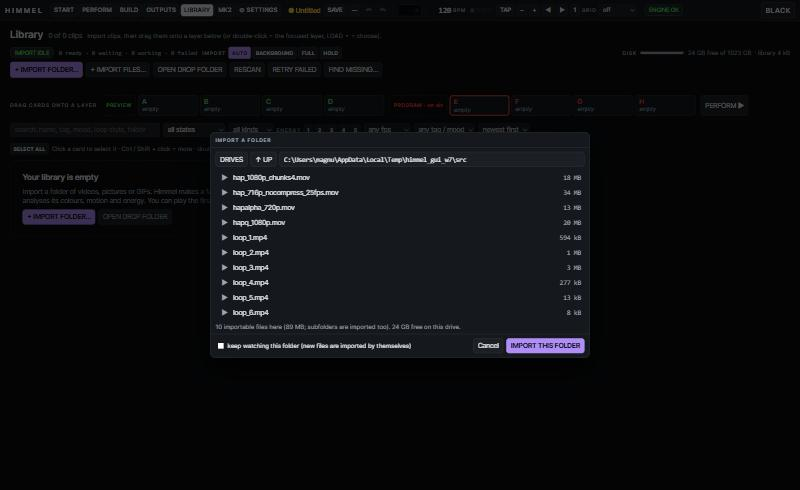
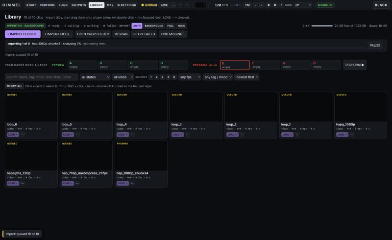
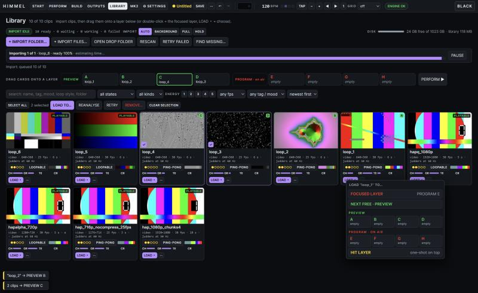
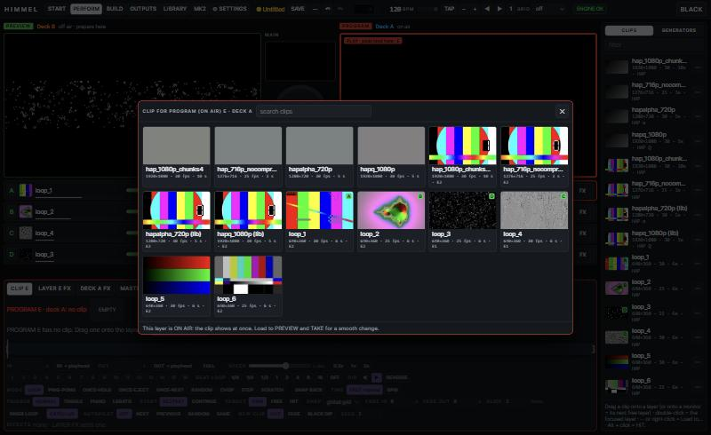
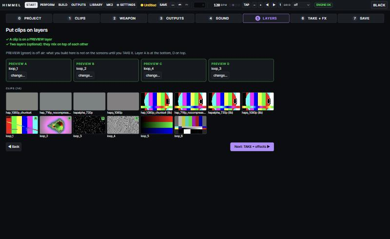
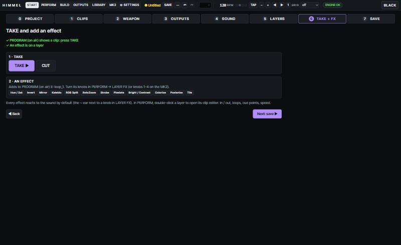
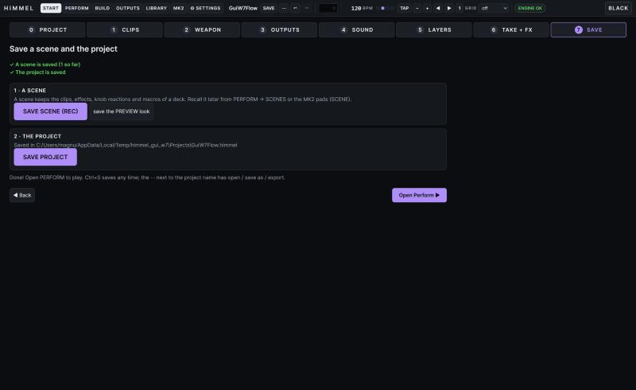
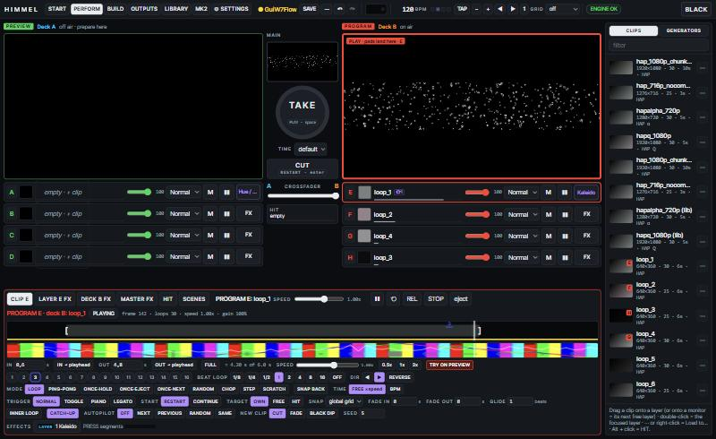
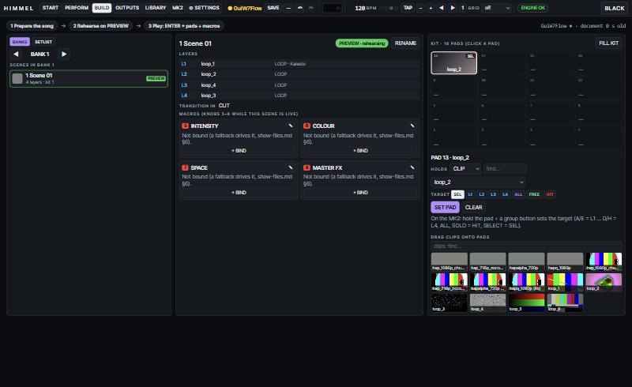

# GUI handoff
Updated: 2026-11-17 by the GUI agent (wave 7) · Branch: `claude/gui-w7-flows` · Last commit: see `git log claude/gui-w7-flows`

## Wave 7: the first-time user's whole flow (2026-11-17)
The owner stopped his user test: "I found no way to get the clips onto layers", and the 89-file import nearly filled
his disk. This wave makes the flow **start → import a folder → watch progress → clips onto layers → TAKE → an
effect → save a scene → save the project** work in the browser without help. No new CommandTypes; the branch
merges MEDIA's wave-7 contract commit `131a896` (library block **v3**), so **merge MEDIA wave 7 first (or together)**:
the bridge opens only a v3 library block.

### Done
- **Clips onto layers from anywhere** (`gui/flows.js`, D171):
  - drag a clip (or several selected cards) onto a strip, a monitor (= its deck's next free layer), the LIBRARY
    dock, a wizard layer or a BUILD kit pad;
  - double-click = the focused layer; ⋯ / right-click / LOAD ▾ = *Load to…* (focused, next free PREVIEW, A–D, E–H, HIT);
  - the **+** on a strip and an empty layer's name ("empty · + clip") open a **clip picker** with thumbnails;
  - group letters on every card and list item show **which layers a clip is on** (green PREVIEW, red PROGRAM).
  - Library row → engine catalog id by ready order + name (D172, GUESS until the catalog carries the library id).
- **LIBRARY view** (`gui/library.js`, D174): search; filters state (incl. playable / on a layer now), kind, energy,
  fps, tag / mood / loop style; sort; multi-select (click, Ctrl, Shift, Ctrl + A) with LOAD TO… / REANALYSE / RETRY /
  REMOVE…; cards drawn 300 at a time; a sticky **layer dock** (PREVIEW A–D, PROGRAM E–H, both decks); empty state
  with IMPORT FOLDER….
  - **Import**: IMPORT FOLDER… / IMPORT FILES… open a path dialog (drives, places, folders, importable files with
    sizes; `GET /fs/list`); options (max 1080p / 720p, HAP Q, skip removed clips, conform 50 / 60) and
    **ESTIMATE DISK** (dry run); a NoSpace refusal offers **IMPORT THE n THAT FIT** or **MOVE LIBRARY…**.
    Files dropped on the page are explained (a browser never gives the path) with OPEN DROP FOLDER (Explorer).
  - **Progress**: "Importing n of m · file · stage % · about N min left", plain-words errors, DISK LOW, PAUSE /
    RESUME (HOLD), **CLEAR QUEUE** (68); the mode chips AUTO / BACKGROUND / FULL / HOLD show the stored mode.
  - **Disk**: free / total and the library's size on the status line (the worker's v3 guard, else `GET /library/disk`).
  - MOVE LIBRARY… (Library 69 + move) with the move's progress on the status line; judder badged only for the
    show's refresh.
- **Clip editor drawer** additions: in / out in seconds, IN / OUT at the playhead, FULL, length, speed slider +
  0.5x / 1x / 2x, brackets snap to analysed cuts (Alt = no snap), Shift + drag = move in and out together, **TRY ON
  PREVIEW** for a layer on air, an empty layer offers CHOOSE A CLIP….
- **Wizard steps 5–7** (D170): LAYERS, TAKE + FX, SAVE, each with a live checklist; step 1 has the real import
  buttons and the progress bar.
- **BUILD**: kit pads take dropped clips (several = consecutive pads), a clip shelf to drag from, a search box in the
  pad editor, an empty state with SAVE PREVIEW AS A SCENE.
- **Tooltips**: an audit script found every visible button / select / input in all views and wizard steps; each
  has a tooltip now (0 left).
- **Bridge**: `GET /fs/list`, `GET /library/disk`, `POST /library/open-originals`; rows carry `order`, `added`,
  `ready_unix`; library block v3 → the `library` event gains `stored_mode`, `disk_low`, `disk{}`, `progress{}`,
  `plan{}`, `root_info{}`; ingest commands ClearQueue / Library, Import options (`height`, `hapq`, `skip_known`,
  `dry_run`, `fit`, `conform_hz`, `files` → a list file in %TEMP%); the bridge follows `root.path` after a move;
  `/names` gains `panels.ingest`. `ui_bridge_tests` **463 checks** (31 new).
- **e2e**: `tools/gui_flow_e2e.py` starts `himmel.exe --sim --no-weapons -- --show-root <temp>` (refuses when any
  himmel process runs), imports a folder (7 files: the 4 HAP test clips + 3 H.264), watches progress, maps rows to
  catalog ids, LayerClip ×2 → TAKE → FxSet → in / out / cue / beat loop / mode / speed → SceneSave → Project SaveAs
  → **kills himmel_ui mid-show** (new PID, renderer PID the same, on-air state identical) → SystemQuit.
  **PASS, 27 checks** (2026-11-17, before the v3 merge; re-run it after MEDIA's worker code lands).

### Screenshots (live, `himmel.exe --sim` on a temp show root, 2026-11-17)
1. Import dialog: 
2. Import progress, n of m: 
3. Library cards on layers (dock + group letters, multi-select): 
4. Clip picker from an empty PROGRAM layer: 
5. Wizard 5 LAYERS: 
6. Wizard 6 TAKE + FX: 
7. Wizard 7 SAVE (scene + project): 
8. Clip editor drawer (in / out in seconds, TRY ON PREVIEW): 
9. BUILD: a clip dropped on kit pad 13, the clip shelf: 

### Not checked live / open
- The v3 fields (progress, disk guard, ClearQueue, estimate, NoSpace, move) are unit-tested in the bridge but not
  live: MEDIA's worker code was not on its branch yet (only the contract). Check them once it merges.
- e2e after the v3 merge: not re-run, because ENGINE w7 had a `himmel_ingest` running on the same machine.
- Hover-to-play, a colour wheel and "find similar" (gui.md §6) are not built.

### GUESSES (wave 7)
- `GUESS:` library row ↔ catalog id by ready order + name (D172).
- `GUESS:` "wizard steps 5+" = steps that walk the rest of the first show (D170).
- `GUESS:` HAP needs about 5× the source bytes, for the warning in the path dialog when no dry run is available.
- `GUESS:` double-click a library card loads onto the focused layer even when that is PROGRAM (a toast says "on air").

## State in one paragraph (wave 5)
M11 part 1 (on main) made every wave-1 engine feature reachable from the browser: transport, the CLIP editor, the
effect browser, PRESS, presets, generators, HIT, clock, the MK2 picture and a settings stub. Part 2 adds a panel for
every block of waves 2–3. Each block is **optional**: missing or the wrong version gives `{"present": false}` and the
panel hides itself; nothing fails.
- **SHOW** (`Local\HimmelShow`): the project bar in the top bar and the SCENES tab.
- **OUTPUTS** (`Local\HimmelOutputs`): the OUTPUTS view.
- **LIBRARY** (`Local\HimmelLibrary` + the library DB, read-only): the LIBRARY view.
- **AUDIO** (`Local\HimmelAudio`): the top-bar meter and Settings → Audio.
- **OSC** (`Local\HimmelOsc`): Settings → Remote / OSC.
- **Weapon blocks** (`Local\HimmelWeapon1..16`): "weapons found".

The start wizard's steps 1–4 use these blocks. The page is plain HTML / JS / CSS with no build step and is dark only:
`index.html`, `app.css` + `m11.css` + `panels.css`, `app.js` + `panels.js` + `views.js`.

**Part 3 (wave 5, branch `claude/gui-m11-part3`)** adds the BUILD view (song / scene / kit editor), the reaction
editor (AUDIO D131), the library actions (MEDIA §10), the clip drawer's filmstrip and the wizard's start screen. The
branch **merges the two contract commits** `aa36c95` (AUDIO FxReact, state v3) and `0e6375e` (MEDIA ingest commands,
library block v2); the bridge needs them, so merge AUDIO and MEDIA first (or together). AUDIO and ENGINE (quit) are
already on main and merged into this branch; MEDIA's contract commit is in, its worker code is not.

## Done in part 3 (wave 5)
- **Bridge:**
  - `GET /show/document`: the project's `autosave/show.json` (or project.json + banks/ + songs/ when that is older),
    trimmed by `show_doc_for_page` (no live part). Read-only.
  - `/library/clips` rows gain `curve` (motion curve, 96 buckets, `downsample_curve`) and `cuts` (0..1).
  - `FxReact` (40) in the JSON codec: `{"op", "param" (knob 0..3, absent = all for Default / Off), "signal", "mode",
    "curve", "quantise", "hold", "f"}` → `pack_react`; clamps like the contract; `command_to_json` writes it back.
  - State v3: the react section → SSE `react` (settings, when `gen` or the epoch changes) and `reactlive`
    (`[env, value]` per knob, ~15 Hz). `/names` gains `react`.
  - `POST /library/cmd` → `IngestCommand` in the GUI channel (slot 1) of the library block v2 (`make_ingest` /
    `push_ingest`); refused when the worker's heartbeat is older than 2 s. The replies are drained by the poller and
    sent in the `library` event as `cmd {sent, done, rejected, applying, replies[8]}`. Watch mode never writes.
  - `fake_engine` plays the reaction table (FxReact ops, FxSet resets, a fake envelope per signal).
  - `ui_bridge_tests`: 432 checks (74 new): every command the BUILD view, the reaction editor and the library
    buttons send, react JSON, ingest parse / reply.
- **QUIT** (ENGINE, SystemQuit 74): `{"type": "SystemQuit", "value": 1}` only (anything else refused in the codec);
  the button is in the project ⋯ menu and Settings → Engine, asks "Quit Himmel?", then shows "HIMMEL HAS QUIT" when the
  bridge goes away.
- **Library rows:** `removed` (tombstones) are hidden; `source_missing` shows a line on the card when the row has it
  (the bridge sends `source_missing` and skips `Removed` rows since MEDIA's v2 records).
- **Page:** `gui/build.js` (BUILD view), `gui/react.js` (ears, knob ghosts, editor), `gui/build.css`; `app.js` (clip
  drawer filmstrip + FX / PRESS row, react events, `H.beatNow`), `panels.js` (library actions), `views.js` (wizard
  step 0, step 3 canvas to scale + blend).
- **Checked live 2026-11-17:**
  - BUILD in my own `himmel-sim-test` stack (the owner's stack was stopped then): REHEARSE, FILL KIT (16 pads read
    back from the autosave), pad 6 → clip on L2, macro binds add / add / remove (packed), setlist new song, BPM 124,
    + scene from PREVIEW, new song 2, ↑, rename. 0 refused. Wizard step 0 + step 3 canvas, clip drawer filmstrip
    (library clip) and FX row. Kill `himmel_ui`: renderer PID the same, state equal apart from playhead positions.
  - Reaction editor against `fake_engine` + `himmel_ui --port 8792`: ear states (default / custom / off), Set with
    Kick / Trigger / 1/4, Range 0.2..1, DEFAULT, OFF, FOLLOW + SOFT graph, knob ghost. 0 refused.
  - **Not checked live:** the library buttons (needs MEDIA's himmel_ingest with block v2) and the reaction editor on
    the real engine (needs AUDIO's renderer). e2e pending (the owner's stack was running).

## Done (with commits)
- **Bridge** (`src/ui_bridge/`):
  - `panels_json.{h,cpp}` (pure, tested): block → JSON, and the SHOW / OUTPUTS commands (25–36, 70–73) with enum names.
    Commands that carry a path or name have a `text` key.
  - `panels_link.{h,cpp}` (Windows): opens the optional blocks, with a heartbeat check per block.
  - SHOW text-box handshake: box id = the command's seq. The bridge writes the box under the push lock, then sends.
  - Writes the AUDIO `config` section (the "one controller").
  - Runs `himmel_audio --list` for the device picker (cached 10 s, 5 s limit).
  - Reads the library DB read-only and serves thumbnails (`<16 hex>.jpg` / `-strip.jpg` only).
  - New SSE events: `show`, `outputs`, `audio`, `osc`, `library`, `weapons`.
  - New routes: `GET /audio/devices`, `POST /audio/config`, `GET /library/clips`, `GET /library/thumb/<file>`;
    `/names` gains `panels`.
  - New args: `--library DIR | --show-root DIR | --no-library`.
  - `ui_bridge_tests`: 358 checks (112 new).
- **Supervisor hook** (marked `GUI (M11 part 2) hook`, in the MEDIA hook 1/3 block of
  `src/engine/supervisor/supervisor_main.cpp`): `himmel_ui` gets the same `--library` as `himmel_ingest`, and
  `--no-library` in test runs (`--no-show-files` / `--no-library`), so a test never reads the owner's library.
- **Page**:
  - `panels.js` (new): the panels listed above.
  - `views.js`: wizard steps 1–4 (import status + drop folder; MK2 + the weapons found; output cards + resolution +
    refresh + IDENTIFY; health + the sound-in picker with a live meter). Settings Audio / Remote are live pages,
    Engine points to OUTPUTS, Controllers lists the weapon drivers.
  - `app.js`: the new events, views OUTPUTS / LIBRARY, the SCENES tab.
- **Docs**: `getting-started.md` "Project, scenes, outputs, library, audio, OSC (M11 part 2)"; D121 PROPOSED; launch
  config `himmel-sim-test` (`himmel.exe --sim -- --show-root build/test-show-root`).
- **Checked live 2026-11-17** with `himmel-sim-test` (my stack only, stopped afterwards; screenshots in the session):
  - All 5 blocks present and alive; 4 weapon drivers found (sim, not connected).
  - SHOW:
    - LayerClip, then REC → "1 saved".
    - Rename through the text box → "Opening".
    - Recall into B: on both decks.
    - Lock Clip, Dice Roll (1/1), Undo (undo 2 / redo 1), bank +1.
    - Save As "GuiTest" → `Projects\GuiTest.himmel`, then edit → ●, then SAVE → clean.
    - 0 refused.
  - OUTPUTS: IDENTIFY (5 s countdown), BLACK OUT 1, SIM: PULL → LOST, blend 64, A2 FIT, A3 OUT 3, 50 Hz. 0 refused.
  - LIBRARY: a HAP clip copied into `originals` went analysing → ready in ~2 s. The thumbnail, analysis and IN SHOW
    show, and the engine catalog has it.
  - AUDIO: the picker lists 14 inputs. USE THIS INPUT → `himmel_audio` switched to "CABLE Output", stereo
    (gen 1 applied). Meters, spectrum and 25 default reactions show.
  - OSC: `/himmel/scene 1` APPLIED, `/himmel/nonsense` REFUSED, newest first.
  - Kill `himmel_ui` mid-show: the supervisor restarted it; the renderer PID stayed the same. `/state` (live, show,
    outputs) was identical apart from the GUI producer's ack counter (and the OSC producer's own Hellos). The page
    reconnected by itself, and a text-box rename and OutputBlack worked through the new bridge.
  - Done-check: build clean, ctest 21/21, 7 Python selftests, `himmel_audio --selftest`, `mk2_e2e.py` PASS.

## In progress
- Nothing open in code. Live checks pending on MEDIA / AUDIO engine code (above).

## Next up (ordered)
1. Check the library buttons and the reaction editor live once MEDIA's and AUDIO's code is merged; show
   `source_missing` on library cards when MEDIA puts it in the rows.
2. AV offset in the GUI. It is only a renderer argument today (`--av-offset`), with no block field and no command.
3. Trigger style / PRESS per kit pad and "Fill song from mood" (no contract yet); scene thumbnails (show-block §3).
4. 4 × 4 pad grid (CLIPS / SLICE / FX PADS) of the v4 mockup; knob tiles 1–4 / 5–8.
5. Effect browser with live thumbnails (needs per-effect previews from the engine), scope badges (FxScope, D106).

## GUESSES
- `GUESS:` the BUILD view edits only the scene on the PREVIEW deck (KitSet / MacroSet act on "the deck's scene");
  REHEARSE is a cut recall into PREVIEW.
- `GUESS:` the deck's variation letter `a` = the main scene, `b` = `variations[0]` in the show document.
- `GUESS:` "Fill kit" = perform.md §4.2's table: clips in catalog order (alpha clips first for the overlays), effects by
  name (strobe, RGB / split, zoom / pulse, freeze / trails), else the next effects.
- `GUESS:` "wizard steps 5+" in the brief = the parts of gui.md §3 still missing: the start screen (as step 0) and the
  canvas drawn to scale with the blend slider. The design has 4 steps.
- `GUESS:` the reaction graph is a sketch of the response (curve, threshold, range, mode), not the engine's maths.
- `GUESS:` the bridge counts a block's writer as alive when its heartbeat moved in the last 1.5 s. For SHOW the
  heartbeat is `ShowStatus.time_us` (written at least every 250 ms).
- `GUESS:` a weapon driver is "alive" when its heartbeat moved since the last check, 1 s earlier.
- `GUESS:` the first `POST /audio/config` starts from what himmel_audio uses now (device, mode, channels) plus the doc
  defaults (auto gain on, gate −60, sensitivity 0.5), because `config.gen` = 0 means "use the command line".
- `GUESS:` a SCENES pad click recalls into the **focused** deck with the scene's own transition (`f = −1`); Alt = cut.
  REC saves the focused deck on the selected pad (or the next free one, `i = −1`).
- `GUESS:` the OUTPUTS view shows output 0's preset as "the" resolution and sends `Resolution` for all outputs.
- Older ones: MK2 consumer ring 3 = the GUI bridge; the clock beat is extrapolated in the page; mouse PRESS = 1.0;
  a generator goes into the first free slot (D107); `fake_engine` drops a released HIT / STOPped layer at once.

## Open questions for the owner
- D100 (slice layout), D120 (M11 layout) and D121 (where the part-2 panels live) are PROPOSED; the defaults are in use.

## How to build / run / test this track
- Build: `cmake --build build --config Release --target himmel_ui fake_engine ui_bridge_tests`
- Test: `build\bin\Release\ui_bridge_tests.exe` (358 checks, also in ctest); `node --check gui/app.js gui/panels.js gui/views.js`.
- Run (test data only): launch config `himmel-sim-test`. It runs `himmel.exe --sim -- --show-root build/test-show-root`;
  the children run in `build/bin/Release`, so the root lands in `build/bin/Release/build/test-show-root`. Then open
  http://127.0.0.1:8790. Read-only second view: launch config `himmel-ui-watch`.

## Wire format (bridge ↔ page), additions in M11 part 2
- Every panel event: `{"present": false, "state": "absent"|"version"|"starting", "panel": name}` when its block is
  not usable, else `present: true` + `alive` + the fields below.
- SSE `show`:
  - `{project, dirty, busy, writable, use_setlist, bank, song, song_count, song_name, song_bpm,
    pads[16]{used, name, variations, on:[a,b], rgb}, decks[2]{scene, pad, variation, edited, morphing, morph,
    dice_pos, dice_count}, locks:[names], undo, redo, macros[4]{name, value}, last_recall_us, scene_count,
    acked, rejected, last_reject` (the GUI slot's)`, message, message_seq, files{…}}`.
  - `files` = `{path, saved_unix, autosave_unix, restored, save_ok, saves, journal_records, relink_found, error,
    recent[]{name, path, saved_unix, outputs}, missing_count, missing[]}`.
- SSE `outputs`: `{count, mode, refresh, fullscreen, identify, identify_left_ms (250 ms steps), canvas[w,h], blend_px,
  blend_gamma, hz_target, hz_measured, displays, config_by_command, outputs[]{state, name, display{maker, product,
  serial, serial_text, connector}, black, preset, identify, size, canvas_x, swap, hz, rect, lost_count, returned_ms,
  blend}, places[9]{place, out, rect}}` (places 0..7 = deck × 4 + layer, 8 = HIT).
- SSE `audio` (~30 Hz):
  - `{sig{level, bass, mid, high, kick, snare, hat, onset, energy, build, drop}, spectrum[32], hits[3], rms_db,
    peak_db, gain_db, gated, clipping, hop, input{…}, clock[]{kind, run, bpm, confidence, phase_valid, beat, port},
    config{gen, applied, mode, device, …}, writable}`.
  - `POST /audio/config` takes the keys of `audio_config_from_json`.
- SSE `osc`: `{port, allow, counts{…}, total, last[]{unix_ms, from, verdict, reason, text}}` (newest first).
- SSE `library`: `{mode, paused, queued, working, ready_total, failed_total, pauses, ready_seq, catalog_full,
  job{name, stage, progress, last_error}, root}`.
- `GET /library/clips` → `{ok, root, clips[]{id, hash, name, kind, state, error, source, codec, size, fps, seconds,
  alpha, judder, thumb, stars, favourite, tags, analysis{…}}}`.
- SSE `weapons` (1 Hz): `[{slot, state, weapon, name, driver, simulated, connected, alive}]`.
- `POST /cmd`, show / output commands:
  - Keys: `deck`, `layer`, `slot`, `param` (an enum name or a number), `value` (or `i`), `f` (a number or up to 4),
    `relative` / `variation` / `clear`, and `text` (Project Open / SaveAs / Export / Relink, SongEdit New / Rename /
    RenameScene, MacroSet rename).
  - Spec + examples: `src/ui_bridge/include/himmel/ui/panels_json.h`; tests: `tests/ui_bridge/ui_bridge_tests.cpp`.

## Gotchas found
- **2026-11-17 incident:** a test script of mine sent LayerClip + FxSet through a browser tab on `127.0.0.1:8790`
  that had become another stack's bridge (MEDIA's test stack, per the LEAD; not the owner's). Rule now: agents run no
  himmel.exe / mk2_e2e / qa_rig in wave 5; test bridges on **port 8792** against `fake_engine`, scripts check
  `location.port` first, close the tab when done.
- **`himmel_ingest.exe` with an unknown flag (`--help`, and `--selftest` before MEDIA's wave 5) starts a real import
  worker on `Documents\Himmel\Library`.** It happened twice (10:15 and 16:47 on 2026-11-17, stopped at once; only
  `ingest.log` written, nothing imported). Never run it without `--library <temp>`.
- **One stack per machine**: check `tasklist` in the same command before starting one, and stop it when you are done.
- **`himmel_ingest` has no `--selftest`.** Run with that flag it starts as a normal import worker on the *default*
  library (Documents\Himmel\Library). It did so once on 2026-11-17 at 10:15 and created an empty library there (no
  files imported). The owner may delete `Documents\Himmel` if it was not there before.
- Git Bash rewrites `/himmel/...` into a file path: send OSC tests with `MSYS_NO_PATHCONV=1`.
- The page draws on `requestAnimationFrame`, so a hidden tab (or a hidden Claude browser pane) draws nothing until it
  is shown. The data (`S`) keeps updating. Call `Panels.render()` / `Views.render()` by hand when you test in a hidden
  pane.
- The SHOW autosave (D109) brings back the last run's state at start: use `--show-root <temp>` for tests.
- The top bar must fit at 1440 px with BLACK visible. Below 1800 px the minor chips (sent / GUI / MK2, then fps) hide;
  they are all on Settings → Status.
- The Bash tool chokes on some heredocs (quotes inside); write a script file with the editor tools instead.
- Space / Enter are TAKE / CUT only in the PERFORM view and never in text / number fields.

## Interfaces touched
- No protocol change: no new CommandTypes, and no block version changed.
- Reads `show-block.md` v1, `outputs-block.md` v1, `audio-block.md` v1, `osc.md` (Local\HimmelOsc v1),
  `library-db.md` v1 (block + DB read-only) and the weapon blocks as written.
- Writes only its own parts: the SHOW text box of producer slot 1, and the AUDIO `config` section.
- Supervisor: the marked GUI hook above.
