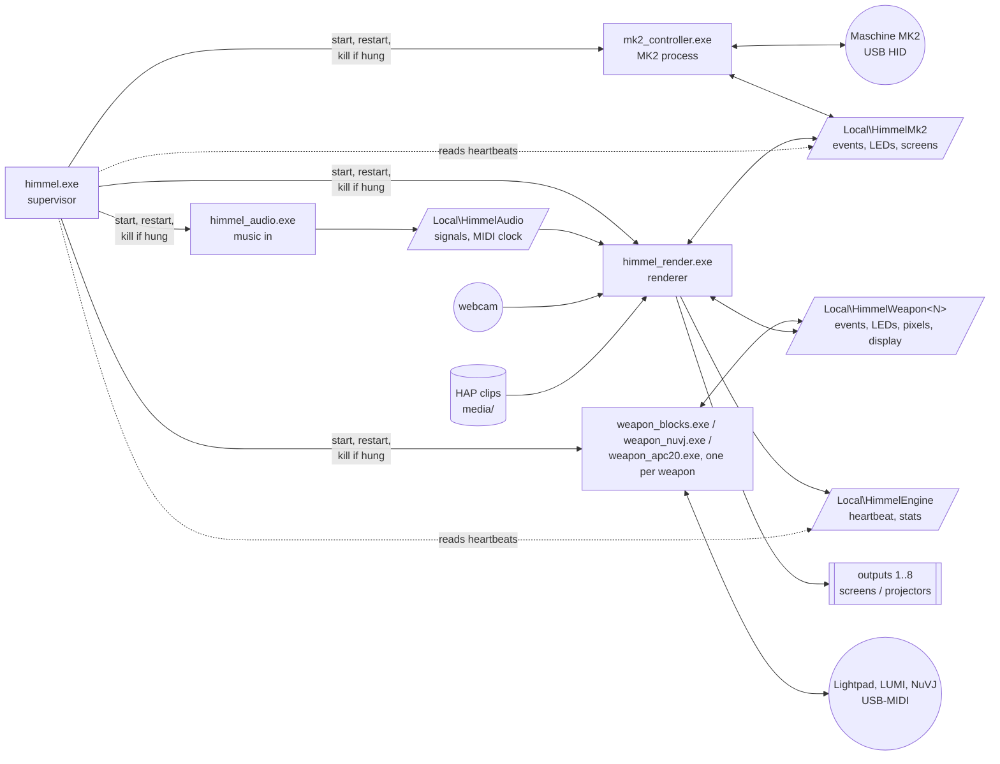
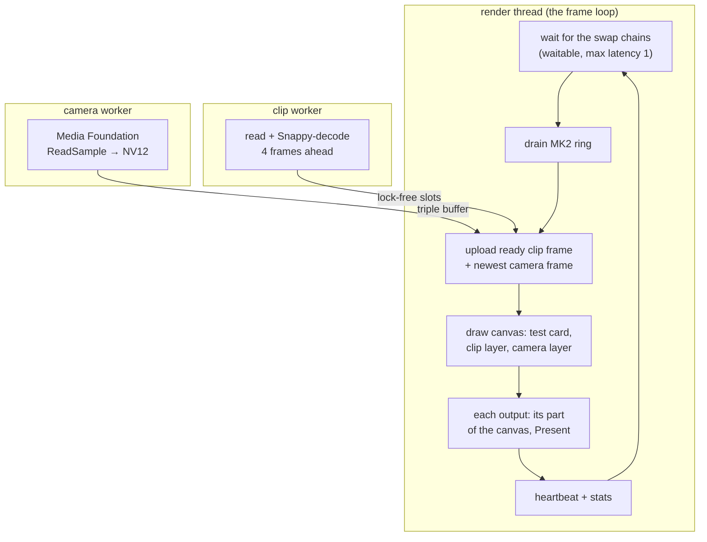
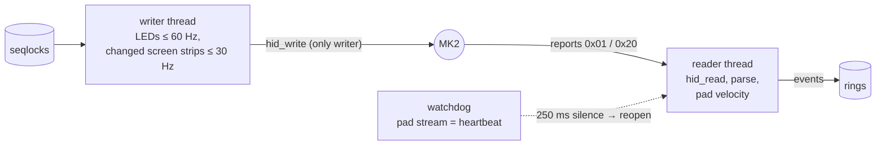

# Architecture

Himmel is built around one rule: **a part that fails must never take down the
output.** So it is several small processes and threads that only meet in
shared memory, and nothing ever waits for anything else.

## Processes



| Process | Job | If it dies |
|---|---|---|
| `himmel.exe` | Starts the others in a job object, watches their heartbeats, restarts them (0.25 s, doubling to 10 s if they keep dying), kills one that has been silent for 2 s, logs everything. | The job object closes all children; start it again. (Run it from a service or a watchdog for unattended installs.) |
| `mk2_controller.exe` | Owns the MK2: reads it at ~750 Hz, publishes events, sends LEDs and screens, reconnects when the cable is pulled. | The renderer keeps playing; it shows "MK2 OFF" and picks the controller up again when it is back (~0.3 s). |
| `weapon_blocks.exe lightpad\|lumi`, `weapon_nuvj.exe`, `weapon_apc20.exe` | One per weapon (`weapons/README.md`): owns the device over WinMM, publishes events, sends LEDs / pixels / LCD, reconnects. Lets go of the device (settings back, LEDs off) on Ctrl+C or the supervisor's stop request. | The renderer keeps playing and picks the weapon up again. |
| `himmel_audio.exe` | Music in (M8, `interfaces/audio-block.md`): WASAPI mic / line in / loopback, auto gain, gate, level / bands / spectrum / kick / snare / hat / energy every 5 ms, MIDI clock in; writes `Local\HimmelAudio`. Reopens a lost device by name every second. | The renderer's reactions glide to rest over 1 s and the picture keeps playing; the supervisor restarts it and they come back. |
| `himmel_render.exe` | The deck engine: model (2 × 4 layers, FX slots, crossfader, TAKE), command ring in, state + preview blocks out, MK2 Perform, outputs. (`himmel_render_legacy.exe`: the parked test card / camera / Touch FX renderer.) | The supervisor restarts it within a second; it restores the show from `Local\HimmelState`. |
| Later: GUI, workers, bridges | Operator GUI (Dear ImGui), import/analysis workers, sync bridges (Ableton Link, Pro DJ Link). | Same rule: the output keeps going. |

## Shared memory

Both blocks are plain structs of atomics in a named file mapping. Any process
can open them; a restarted process re-opens the same block and carries on.

**`Local\HimmelMk2`** (`src/controller/include/himmel/mk2/shared.h`, spec:
[mk2-controller-spec.md](mk2-controller-spec.md))

- 4 single-producer/single-consumer **event rings** (one per consumer: ring 0 =
  the renderer, the last free ring = test clients). 16-byte events: button
  down/up, knob delta, encoder delta, pad hit (velocity), pad pressure, pad
  release, connected/disconnected, each with a microsecond timestamp.
- **LED state** and the **two 256×64 screens** behind seqlocks: the app writes
  whole states, the controller sends only what changed.
- **Status**: connected, heartbeat, counters, last message.

**`Local\HimmelWeapon<N>`** (`src/controller/include/himmel/weapon/shared.h`), one
per weapon slot (default slot = the weapon's number):

- The same rings (16-byte events; new types TouchStart/Move/End, Fader, Switch)
  and seqlock outputs as the MK2 block, plus a **header** naming the weapon, its
  profile and what each control does (role, knob slot, pad numbers), so the
  renderer needs no weapon-specific code.
- Outputs: LED levels per control, RGB pixels (Lightpad 15 × 15, LUMI 24), a
  segment-display model (NuVJ LCD).
- Status: connected, heartbeat, counters, battery, ACK timing, stop request.

**`Local\HimmelEngine`** (`src/engine/include/himmel/engine/engine_shared.h`):
heartbeat, fps, frame times, late frames, input → present latency, stop request.

**`Local\HimmelShow`** (`src/protocol/include/himmel/protocol/show.h`, M3,
[interfaces/show-files.md](interfaces/show-files.md)): the show status (project,
dirty dot, the scenes on the page, the scene on each deck, undo depth, locks,
macros, acks of show commands), the save worker's file status (path, last save,
autosave / restore, recent projects, missing clips) and one text box per
producer for paths and names.

All timestamps are `steady_clock` (QueryPerformanceCounter), which is the same
clock in every process, so latency can be measured across processes.

## Threads inside the renderer



**Frame-loop rules** (from `CLAUDE.md`): no allocation, no locks, no disk I/O
in the frame loop. Loading, parsing, decoding and capture happen in workers;
the frame loop only takes what is ready and never waits for it. A clip frame
that is not ready keeps the last one on screen; a broken frame turns black
instead of stopping the clip.

**Clip slots**: Free → Writing (worker) → Ready → Reading (renderer) → Ready.
Only compare-and-swap moves a slot between threads.

**Camera**: classic lock-free triple buffer (one atomic index swap per frame).

**The show (M3, `src/show/`)**: show commands (types 25–36) go to the
`ShowRuntime` in the frame loop. It turns recall / morph / undo / dice into
ordinary commands on slot 4 (only what differs, in one frame) and never
touches disk. Its **save worker thread** does every file: project save /
open / export, the autosave journal (live state, ≤ 10 records/s),
`autosave/show.json`, snapshots every 5 minutes. The frame hands it copies
through preallocated buffers and SPSC rings; a loaded show comes back as a
pointer swap at a frame boundary.

## Inside the controller



- The pad report streams all the time (~750 Hz), so silence means the device is gone.
- **Simulated MK2** (`mk2_controller --sim`, `himmel --sim`): the device under the
  reader and writer is a UDP socket on 127.0.0.1:8766 instead of USB
  (`sim_link.h`). The simulator in `tools/mk2_live.py` sends the same raw
  reports; LED and screen reports go back to it, plus a 1-byte hello (`0xFE`)
  every 250 ms so it knows a controller listens. Parsing, velocity, events,
  LEDs and screens are the same code. Heartbeat timeout 1 s instead of 250 ms.
- Pad velocity = highest pressure in the first 4 ms after onset (measured: the
  peak cannot tell soft from medium), with a per-pad noise floor and a 25 ms
  re-trigger hold-off against release rebound.
- Knobs and the encoder are absolute and wrap; the controller turns them into deltas.

## Inside a weapon driver

One thread: read MIDI (WinMM callback → queue, or UDP for `--sim`), decode,
publish events, and at least every millisecond run the timers. For BLOCKS the
ping is checked before any LED packet, so it never waits behind LED traffic;
LED frames go as `sharedDataChange` diffs only after the last frame is ACKed.
The run loop (`driver.h`) reopens the device when the port disappears or the
simulator goes quiet.

## Rendering

- Direct3D 11, one **flip-model swap chain per output** with the waitable
  object and maximum frame latency 1: the loop renders as late as possible.
- One **canvas** texture: span (outputs side by side, a red line marks each
  seam on the test card) or mirror.
- **HAP frames are uploaded as BC1/BC3 textures**; the GPU decompresses them for
  free while sampling. Hap Q's YCoCg → RGB happens in the shader.
- **Camera**: NV12 planes uploaded as R8 + R8G8 textures, BT.709 → RGB in the shader.
- The MK2 screen pages are drawn on the CPU (512×64 bits) at ~30 Hz.
- **Effects and generators** (`fx/`, `src/engine/fx/`, M5): one pixel shader
  per effect, all compiled at start-up in worker threads; each active FX slot
  is one full-screen pass on the chain's ping-pong pair. Per slot and frame the
  CPU resolves scope → PRESS → reaction → flash cap (pure maths) and maps one
  constant buffer. Trails use a pool of 4 feedback textures made at resize.
  Contract: `docs/interfaces/effect-metadata.md`.

## Source map

```
src/controller/   himmel_mk2 library: map, input parsing + pad tracker, LED/screen reports,
                  shared memory, controller threads, screen pages (pages.h)
                  app/: mk2_controller, mk2_monitor, mk2_pages_demo, mk2_pages_check
                  himmel_weapon library (src/weapon/): weapon shared block, MIDI links,
                  driver run loop, BLOCKS codec + session, NuVJ codec + session
                  app/: weapon_blocks, weapon_nuvj, weapon_apc20, weapon_monitor
src/media/        himmel_media: MOV reader, HAP decoder; tools/hap_probe
src/show/         himmel_show_model (show model, looks -> commands, dice), himmel_show
                  (files, journal, zip, ShowRuntime + save worker); tools/show_cmd;
                  tests in tests/show/ (show_tests, show_crash_test)
src/engine/       engine_shared (status block), clip_player, camera_capture,
                  fx/ (himmel_fx: metadata + resolve; himmel_fx_gpu; fx_tests, fx_check),
                  render/ (himmel_render + shaders), supervisor/ (himmel)
tests/            controller/mk2_tests.cpp, controller/weapon_tests.cpp, media/media_tests.cpp
fx/               effects + generators: <id>/effect.json + <id>/<id>.hlsl, catalog.json
tools/            fx_check/ (C++); Python: MK2 live view + mapper, screen prototypes and fun modes, measurements
```

## Measured on the dev PC (GTX 1070)

| | |
|---|---|
| Frame time | 16.67 ms steady at 60 Hz, a handful of late frames per 15 min |
| MK2 event → Present() | 8–15 ms |
| HAP 1080p read + decode | 0.2–0.9 ms per frame (Hap), up to ~1.5 ms (Hap Q) |
| Renderer restart after a crash | < 1 s |
| MK2 pad report interval | 1.33 ms; knob reports ~10 ms; one knob turn ≈ 1008 units; encoder 30 detents/turn |
