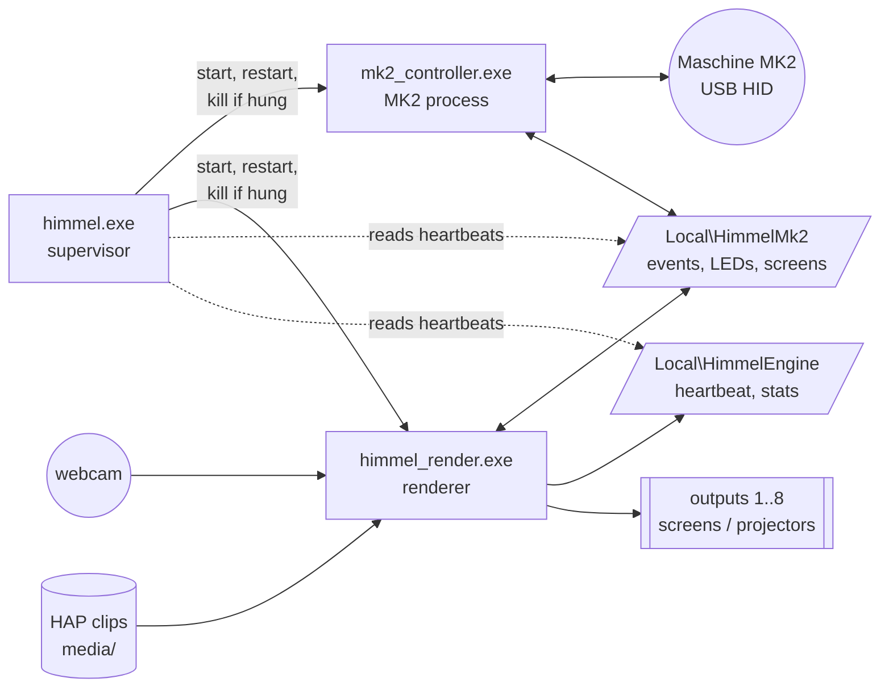
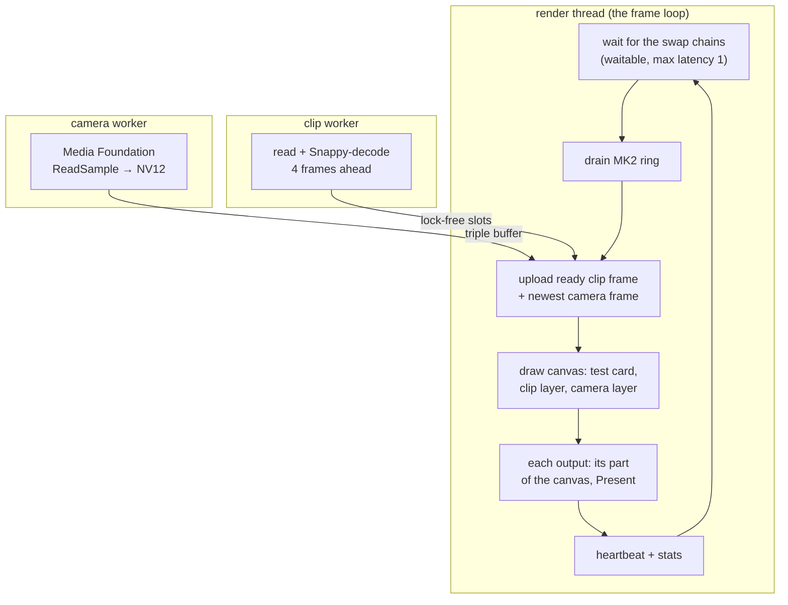
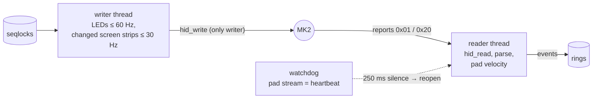

# Architecture

Himmel is built around one rule: **a part that fails must never take down the
output.** So it is several small processes and threads that only meet in
shared memory, and nothing ever waits for anything else.

## Processes



| Process | Job | If it dies |
|---|---|---|
| `himmel.exe` | Starts the others in a job object, watches their heartbeats, restarts them (0.25 s, doubling to 10 s if they keep dying), kills one that has been silent for 2 s, logs everything. | The job object closes all children; start it again. (Run it from a service or a watchdog for unattended installs.) |
| `mk2_controller.exe` | Owns the MK2: reads it at ~750 Hz, publishes events, sends LEDs and screens, reconnects when the cable is pulled. | The renderer keeps playing; it shows "MK2 OFF" and picks the controller up again when it is back (~0.3 s). |
| `himmel_render.exe` | Outputs, canvas, test card, clips, camera, MK2 control. | The supervisor restarts it within a second. |
| Later: GUI, workers, bridges | Operator GUI (Dear ImGui), import/analysis workers, sync bridges (Ableton Link, Pro DJ Link). | Same rule: the output keeps going. |

## Shared memory

Both blocks are plain structs of atomics in a named file mapping. Any process
can open them; a restarted process re-opens the same block and carries on.

**`Local\HimmelMk2`** (`src/controller/include/himmel/mk2/shared.h`, spec:
[mk2-controller-spec.md](mk2-controller-spec.md))

- 4 single-producer/single-consumer **event rings** (one per consumer: ring 0 =
  the renderer, the last free ring = test clients). 16-byte events: button
  down/up, knob delta, encoder delta, pad hit (velocity), pad pressure, pad
  release, connected/disconnected, each with a microsecond timestamp.
- **LED state** and the **two 256×64 screens** behind seqlocks: the app writes
  whole states, the controller sends only what changed.
- **Status**: connected, heartbeat, counters, last message.

**`Local\HimmelEngine`** (`src/engine/include/himmel/engine/engine_shared.h`):
heartbeat, fps, frame times, late frames, input → present latency, stop request.

All timestamps are `steady_clock` (QueryPerformanceCounter), which is the same
clock in every process, so latency can be measured across processes.

## Threads inside the renderer



**Frame-loop rules** (from `CLAUDE.md`): no allocation, no locks, no disk I/O
in the frame loop. Loading, parsing, decoding and capture happen in workers;
the frame loop only takes what is ready and never waits for it. A clip frame
that is not ready keeps the last one on screen; a broken frame turns black
instead of stopping the clip.

**Clip slots**: Free → Writing (worker) → Ready → Reading (renderer) → Ready.
Only compare-and-swap moves a slot between threads.

**Camera**: classic lock-free triple buffer (one atomic index swap per frame).

## Inside the controller



- The pad report streams all the time (~750 Hz), so silence means the device is gone.
- Pad velocity = highest pressure in the first 4 ms after onset (measured: the
  peak cannot tell soft from medium), with a per-pad noise floor and a 25 ms
  re-trigger hold-off against release rebound.
- Knobs and the encoder are absolute and wrap; the controller turns them into deltas.

## Rendering

- Direct3D 11, one **flip-model swap chain per output** with the waitable
  object and maximum frame latency 1: the loop renders as late as possible.
- One **canvas** texture: span (outputs side by side, a red line marks each
  seam on the test card) or mirror.
- **HAP frames are uploaded as BC1/BC3 textures**; the GPU decompresses them for
  free while sampling. Hap Q's YCoCg → RGB happens in the shader.
- **Camera**: NV12 planes uploaded as R8 + R8G8 textures, BT.709 → RGB in the shader.
- The MK2 screen pages are drawn on the CPU (512×64 bits) at ~30 Hz.

## Source map

```
src/controller/   himmel_mk2 library: map, input parsing + pad tracker, LED/screen reports,
                  shared memory, controller threads, screen pages (pages.h)
                  app/: mk2_controller, mk2_monitor, mk2_pages_demo, mk2_pages_check
src/media/        himmel_media: MOV reader, HAP decoder; tools/hap_probe
src/engine/       engine_shared (status block), clip_player, camera_capture,
                  render/ (himmel_render + shaders), supervisor/ (himmel)
tests/            controller/mk2_tests.cpp, media/media_tests.cpp
tools/            Python: MK2 live view + mapper, screen prototypes and fun modes, measurements
```

## Measured on the dev PC (GTX 1070)

| | |
|---|---|
| Frame time | 16.67 ms steady at 60 Hz, a handful of late frames per 15 min |
| MK2 event → Present() | 8–15 ms |
| HAP 1080p read + decode | 0.2–0.9 ms per frame (Hap), up to ~1.5 ms (Hap Q) |
| Renderer restart after a crash | < 1 s |
| MK2 pad report interval | 1.33 ms; knob reports ~10 ms; one knob turn ≈ 1008 units; encoder 30 detents/turn |
