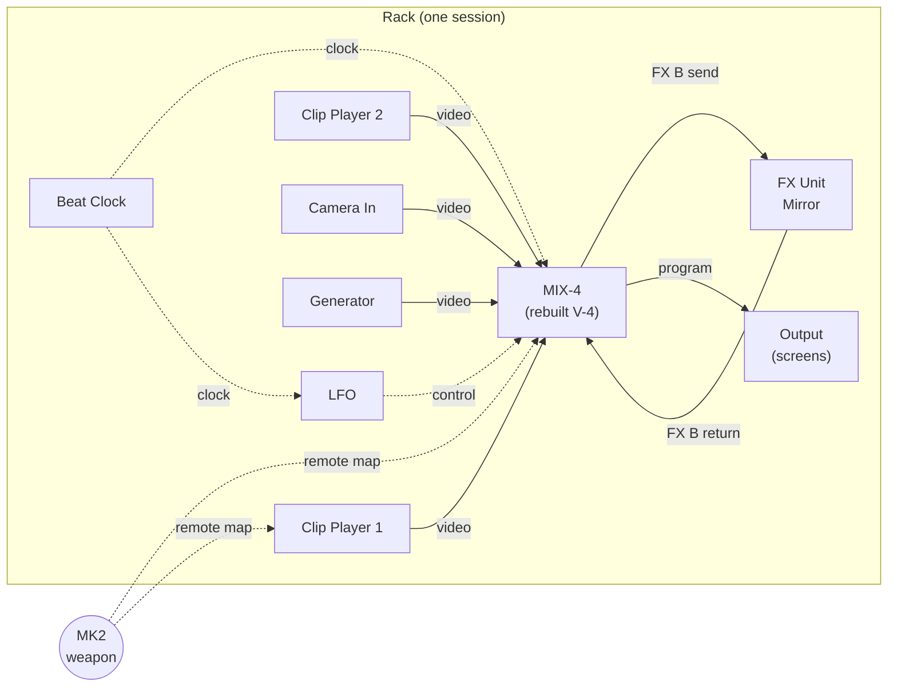
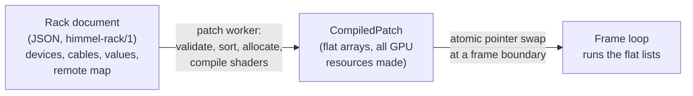
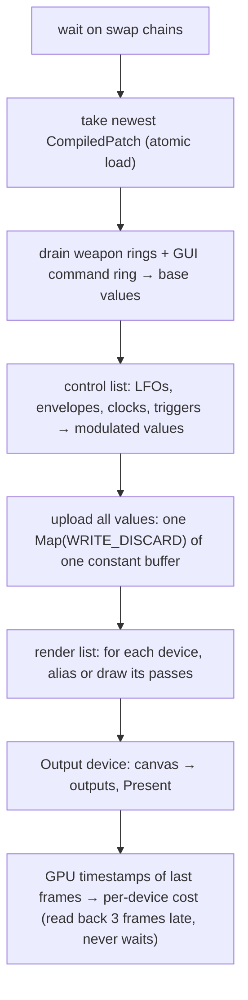
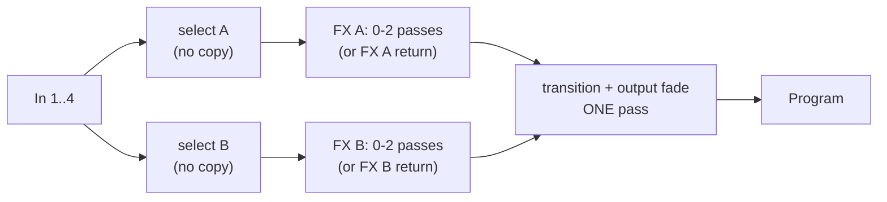

# The Himmel rack: patchable devices (design proposal)

**Status: proposal, 2026-11-10. No engine code yet.** Decisions marked
**[owner]** are open and must be made by the owner before code is written
(see [Open decisions](#11-open-decisions-for-the-owner)).

The owner's idea (2026-11-10, while cataloguing the V-4): build Himmel like
Reason. A **rack** of **devices**, each with a front (knobs, buttons, small
screens) and a back (sockets). You turn the rack around and patch **cables**
between sockets to build effects and mixing. Controllers (weapons) are patched
to the knobs.

Mockup of the rack view, front and back: [`rack-mockup.html`](rack-mockup.html)
(open it in a browser; Tab flips the rack).

Goals, in the order from `CLAUDE.md`:

1. **Show-safe**: a broken device, cable or patch never takes down the output.
2. **Minimal latency**: a knob turn reaches the screen in the next frame.
3. **Easy to use**: you never *have* to look at the back. Ready-made racks,
   auto-cabling, one big T-bar.
4. **Light on the GPU**: a device costs nothing when it is not seen, and
   simple effects cost one cheap pass or less.

---

## 1. The idea in one picture



Everything in the rack is a **device**. A device is a small, self-contained
piece of the engine: a source (clip, camera, generator), a processor (effect,
keyer, mixer), a modulator (LFO, envelope, beat clock, audio analysis) or a
sink (Output). The existing engine pieces (`ClipPlayer`, `CameraCapture`, the
test card, the canvas and outputs) become the first devices.

Reason words → Himmel words:

| Reason | Himmel | Notes |
|---|---|---|
| Rack | **Rack** | One per session. |
| Device | **Device** | Native C++ type, or later an ISF shader device. |
| Audio cable | **Video cable** | Carries a texture. |
| CV cable | **Control cable** | Carries a number per frame. |
| Gate | **Trigger cable** | Carries "it happened" events per frame. |
| (MIDI clock / Link) | **Clock cable** | Carries BPM + beat phase. |
| Hardware Interface | **Output** device | Always there, cannot be deleted. |
| Combinator | **Combi** | A group of devices with macro knobs; the deck preset. |
| Remote (control surfaces) | **Remote map** | How weapons drive knobs. |
| Patch (.rv7 etc.) | **Device patch** | The effect-preset level. |

---

## 2. The device model

### 2.1 Ports

A device declares its ports in a static table (compiled in, not built at run
time). There are four port types. Each has a cable colour in the GUI.

| Type | Carries | Per frame | Colour | Example |
|---|---|---|---|---|
| **Video** | A texture reference: SRV + size + "has alpha". Premultiplied alpha. | one texture | blue | Clip Player → MIX-4 input 1 |
| **Control** | One `float`. Unipolar 0..1 or bipolar −1..1 (declared per port). | one value | green | LFO → MIX-4 T-bar |
| **Trigger** | Rising edges this frame (count) + current gate level (0/1) + velocity of the last edge. | small struct | orange | MK2 pad 1 → MIX-4 Transformer A |
| **Clock** | BPM, beat position (double, in beats), beats per bar, running flag. | small struct | purple | Beat Clock → MIX-4 BPM sync |

Audio is **not** a port type. Audio analysis is a device (Audio Analyzer) that
turns sound into Control and Trigger outputs (levels, bands, onsets) and a
Clock output (BPM, phase). Audio itself stays in its own worker / process.

Rules for ports:
- **One cable per input, many cables per output** (fan-out is free: it is the
  same texture or value). To merge controls, use a **Merger** device (sum, max,
  multiply); to merge video, use a mixer. This keeps every input's value
  well-defined.
- **Unpatched inputs have a defined value**: video = transparent black,
  control = the device's own default, trigger = nothing, clock = the rack's
  master clock. A device never sees "null".
- Types never convert silently. A small **Converter** device does it on
  purpose (trigger → control as a hold or envelope, control → trigger as a
  threshold, video → control as average luma / motion).

### 2.2 Parameters and modulation (front panel)

Every knob, fader, button and selector on the front is a **parameter**. A
parameter has:

- a stable `id` (`"tbar"`, `"fx_a.control"`), used by presets, remote maps and
  files. Never renamed once released;
- a range, a default, a unit and a display format ("0.42", "128 BPM", "WIPE 17");
- a kind: continuous, stepped (selector), toggle, momentary;
- optional **Smart Random hints**: a "safe" sub-range and mood tags
  (lounge ↔ techno), so Smart Random knows what is a good random value;
- an optional **modulation input** on the back (like Reason's CV in with a trim
  knob). If patched:
  `value = clamp(base + trim × cable)`, where `base` is the knob.

So a knob always shows where it *is* (base) and, with a thin ring, where it is
*now* (modulated). You can always grab the knob, even while an LFO drives it.

### 2.3 What a device type implements

In C++ (sketch, not final API):

```cpp
struct DeviceType {
    const char* id;                 // "mix4", "clip_player", "lfo" ...
    std::span<const PortDesc>  ports;
    std::span<const ParamDesc> params;
    GpuCost cost;                   // declared passes and texture size, for the budget

    // Worker thread, never in the frame loop: may allocate, compile, load.
    std::unique_ptr<DeviceState> (*create)(const CreateContext&);

    // Frame loop: must not allocate, lock, wait or touch the disk.
    void (*control)(DeviceState&, const ControlIn&, ControlOut&);   // CPU, every frame
    void (*render)(DeviceState&, const RenderIn&, RenderOut&);      // GPU passes, only if the output is used
};
```

- `create` runs in the **patch worker** (see 3.2) and gets everything it needs
  up front: textures, shaders, constant buffers, worker threads (a Clip Player
  owns a `ClipPlayer` decode worker, as today).
- `control` is pure CPU math on a few floats (LFO, envelope, beat logic, T-bar
  auto-take). It runs every frame for every device, in patch order.
- `render` records GPU work into the frame. It may **alias** its output to an
  input (no pass at all) when it has nothing to do: an effect at 0 %, a mixer
  with the T-bar fully on one side, a bypassed device.

Native devices only. **No DLL plug-ins in the renderer**: a third-party DLL
can crash the process that drives the screens. User-made devices are **ISF
shaders** (already in the stack), compiled in the worker, so a bad shader
fails at load and the device shows an error instead. **[owner]**

---

## 3. From patch to render graph (and the render-loop rules)

### 3.1 Three layers



1. **Rack document**: what the user built. Plain data, JSON on disk
   (`shows/<name>/rack.json`), the same data in memory in the GUI.
2. **CompiledPatch**: what the renderer runs. Built by a worker, immutable
   once published. It holds:
   - a flat **control list** (devices in dependency order, each with indices
     into one big `float` array of parameter and cable values);
   - a flat **render list** (only devices that can reach the Output, in order);
   - every texture, render target, shader and constant buffer already created;
   - a fixed-size **value block** (parameters, modulation, cable values).
3. **Frame loop**: walks the two lists. No lookups by name, no maps, no
   strings, no `new`.

### 3.2 The patch worker

A thread in `himmel_render.exe` (not the frame loop) that owns rack editing:

1. Takes an edit (from the GUI, a file, or a preset recall that changes
   structure).
2. **Validates**: port types match, one cable per input, ids exist.
3. **Sorts** the graph topologically. **Cycles**: a video or control loop is
   only allowed through a **Frame Delay** device (feedback = last frame's
   texture / value). Any other cycle is refused with a clear message on the
   cable. This gives video feedback effects without an undefined order.
4. **Prunes**: devices whose outputs never reach the Output (or a Preview /
   Spout / NDI sink) get no render step. Their `control` still runs if a
   control cable from them is used.
5. **Allocates** textures from a pool, reusing a texture once its last reader
   has run (lifetime analysis, like a frame graph). A typical rack needs a
   handful of canvas-size textures, not one per device.
6. **Creates** devices that are new; **moves** the state of devices that
   survive the edit (a playing clip keeps playing, an LFO keeps its phase).
7. **Publishes** the new `CompiledPatch` with one atomic pointer store.

The frame loop picks up the new pointer **at the start of a frame** and uses
it for the whole frame. The old patch is retired; the worker frees it a few
frames later (after a GPU fence says the GPU is done with it). That is the
only hand-over, and it is wait-free for the frame loop.

### 3.3 Two kinds of change

| Change | Example | Path | Cost in the frame loop |
|---|---|---|---|
| **Value** | turn a knob, recall a device patch, a weapon moves the T-bar | written straight into the value block (weapon events are already drained in the frame loop; GUI edits come through an SPSC command ring) | a store |
| **Structure** | add a device, plug a cable, change an effect's shader | patch worker builds a new `CompiledPatch` | one pointer swap, a frame later |

Most of a show is value changes. Structure changes during a show are allowed
but rarer; they cost no hitch in the frame loop because all the work is done
in the worker before the swap.

### 3.4 One frame



Control flows in the **same frame**: a knob turn, an LFO and a pad trigger all
reach the picture in the next Present. That keeps today's ~8–15 ms
MK2 → Present.

### 3.5 Show-safety: what happens when a part fails

| Failure | What the rack does |
|---|---|
| A device fails to create (shader does not compile, file missing, camera gone) | The device is marked **faulted** in the patch: its outputs **pass through** its main video input (or transparent black for sources; the last good frame for clips and cameras). Red LED on its front. The rest of the rack runs. |
| A source is not ready (clip still loading, camera reconnecting) | Last good frame, as today. Never waits. |
| A patch edit is invalid (cycle, wrong type) | The edit is refused in the worker; the running patch is untouched. |
| The GUI dies | Nothing changes on screen. The live rack is in the renderer; the GUI reconnects and reads it back. |
| A weapon dies | The knobs keep their last values (as today: "MK2 OFF"). |
| The renderer dies (GPU device lost, crash) | The supervisor restarts it (< 1 s, as today). It reloads the **last good rack** from the autosave the patch worker writes after each successful compile (never the frame loop). |
| The same rack kills the renderer twice in a row | **Quarantine**: on the next start the device type that was last added or changed starts **bypassed**, and the GUI says so. The show goes on without it. |
| Everything is wrong | **Panic** on the Output device (and on a weapon): cut to the **safe source** (black, a logo, or a patched "safe" input) in the next frame, bypassing the whole graph. |

The Output device is special: it always exists, it cannot be deleted, and it
is the last step of every frame. If its input is faulted it shows the safe
source, never the desktop.

### 3.6 Where the rack lives (processes)

- **`himmel_render.exe`** owns the **live** rack: the patch worker, the
  compiled patch and the value block. It is the authority on values, because
  weapons and modulation change them every frame.
- It publishes a read-only mirror in a new shared block **`Local\HimmelRack`**
  (seqlock): patch revision, every parameter's base and modulated value, device
  states (ok / faulted / bypassed), per-device GPU time. The GUI draws from it.
- **The GUI** sends edits over an SPSC **command ring** in the same block
  (values) and a **patch mailbox** (structure: a new rack document as JSON,
  with a revision number). It saves the rack to disk itself; the renderer's
  autosave is the safety copy.
- **Thumbnails** for the GUI (small previews of each device's output) are
  drawn by the renderer into one shared texture atlas at a low rate (e.g.
  10 Hz, only for devices visible in the GUI), handed over with an index flip
  like the camera triple buffer. No keyed mutex, no waiting.
- Weapons stay where they are (controller processes, event rings). Sync bridges
  (Ableton Link, Pro DJ Link, LTC) publish their clock into shared memory; the
  **Beat Clock** device reads it.

---

## 4. Worked example: MIX-4, a rebuilt V-4

The first big device. It rebuilds the V-4 video mixer (weapon no. 7, full
catalogue in [`v4-effects.md`](v4-effects.md)) as Himmel's own GPU code. It is
called **MIX-4**, not "V-4" (trademarks: the drawing never uses the maker's name
or logo). **[owner]** for the name.

### 4.1 Front panel (6U)

```
┌──────────────────────────────────────────────────────────────────────────────┐
│ MIX-4  ▣1 ▣2 ▣3 ▣4  ▣PGM   (input + program thumbnails)     MEMORY 1 2 3 4 5 6 7 8 │
│ CH A                       │  MIX  WIPE  EFX   │                        CH B │
│ SOURCE  [1][2][3][4]       │      ║T-BAR║      │       [1][2][3][4] SOURCE │
│ EFFECT  [A1][A2][A3][A4]   │  TRANSF A  TRANSF B│   [B1][B2][B3][B4] EFFECT │
│ CONTROL ◯                  │  BPM SYNC  TAP  ×½ ×1 ×2│              ◯ CONTROL │
│                            │  OUTPUT FADE ◯ (black ← → white)              │
└──────────────────────────────────────────────────────────────────────────────┘
```

Every control is a parameter (2.2): `src_a`, `src_b` (1–4), `fx_a.1..4` and
`fx_b.1..4` (toggles), `fx_a.control`, `fx_b.control`, `tbar`, `trans` (MIX /
WIPE / EFX), `trans.mix_pattern`, `trans.wipe_pattern`, `trans.efx_pattern`
(each 1–248), `transformer_a`, `transformer_b` (momentary), `transformer.mode`
(1–36), `bpm_sync`, `bpm_rate`, `fade`, `fade.mode`. Effect-button assignments
(which of the 96 patterns sits on A1…B4), PinP boxes and key settings are
parameters too, set in a detail view (the V-4's menu), stored in memories.

### 4.2 Back panel (sockets)

| Group | Sockets |
|---|---|
| Video in | In 1, In 2, In 3, In 4 |
| Video out | **Program**, Preview (multiview: 4 inputs + program in one picture; only rendered if patched), Ch A, Ch B (post-effect, for monitoring) |
| Insert (send / return) | **FX A send**, **FX A return**, FX B send, FX B return. If a return is patched, it replaces channel A's/B's built-in effects: the Reason way to put any external effect device in the channel. |
| Control in (modulation) | T-bar, Control A, Control B, Fade, Source A, Source B |
| Trigger in | Transformer A, Transformer B, Take (auto transition), Cut, Tap, Effect A1–A4, B1–B4 (toggle) |
| Clock in | Clock (BPM sync and strobe rates; unpatched = rack master clock) |
| Control out | T-bar (so other devices can follow the mix) |
| Trigger out | Beat (from BPM sync), On A, On B (when the mix lands on a side) |

### 4.3 Inside: how it renders (and what it costs)



- **Source select** is just which texture is bound. Free.
- **Effects**: the 96 patterns are tiny pixel shaders (see the catalogue): one
  shader per family (negative, colorize, monocolor, posterize, colorpass,
  keys, multi, mirror, PinP, shake) with the variant and the CONTROL value as
  constants. Several active effects on one channel are **fused into one
  pass** when they are all per-pixel (colour effects) or UV-only (mirror,
  multi, shake): UV effects change where we sample, colour effects change what
  we do with the sample, so `colour(sample(uv_effects(uv)))` is one shader.
  The fused shader variants are compiled in the worker when the effect
  assignment changes, never in the frame loop. **STILL** and **STROBE** cost
  no shader: they keep a held texture (one copy when the hold starts).
- **Transition**: one shader for all 248: mix, 72 wipe shapes × 3 edges
  (hard, soft, multi-colour border) as shape functions compared with `t`,
  4 key transitions, 27 slides as UV offsets. The output fade (to black /
  white) is folded into the same pass.
- **Aliasing**: T-bar fully at A, no effects on A, fade 0 → Program *is* the
  input texture. Zero passes. Channel B is not rendered at all while the T-bar
  rests on A (unless its outputs are patched elsewhere).

| State | Fullscreen passes |
|---|---|
| T-bar at one side, no effects | 0 |
| T-bar at one side, effects on that channel | 1 |
| Mid-transition, effects on both channels | 3 (worst case without PinP) |
| + PinP | +1 small quad |

**Rough cost** (to be measured, not guessed, as the working rules say): a
simple fullscreen pass at 1920×1080 moves ~16 MB (read + write). That is
roughly 0.1–0.2 ms on the dev GTX 1070 and well under 0.05 ms on the RTX 5090.
So MIX-4's worst case is under 1 ms on the 1070 at 1080p, and the usual case is
0–1 pass.

### 4.4 Memories

The V-4's 8 memories become **8 device patches** stored in the MIX-4's state
(see 6). Memory 1 is the factory set (read-only, like the V-4). Recalling a
memory is a **value change** (all of it is parameters), so it is instant. If
the new effect assignment needs a fused shader that is not compiled yet, the
patch worker builds it, and until it is ready the old variant keeps running
(one or two frames).

### 4.5 MIX-4 as a native device, not (yet) a Combi

MIX-4 could be a Combi of small devices (two 4-way switches, two FX units, a
transition device). That would be a nice demonstration, but the fused passes,
aliasing and the V-4-style panel are much easier as one native device.
Proposal: **native in milestone 1**, built from the same shader library as the
small devices (FX Unit, Transition, Keyer), so a Combi version can come later.
**[owner]**

---

## 5. Weapons → knobs: the remote map

Two ways, and both compile to the same thing (a write into the value block in
the frame loop):

### 5.1 Remote map (the normal way)

Like MIDI learn, and like the live view's click-then-press relearning:
**click a knob in the rack, then move a control on the weapon.** The pairing is
stored in the rack's **remote map**, not in the device, so the same rack works
with another weapon (or a simulated one).

| Weapon control | Parameter kind | Behaviour |
|---|---|---|
| Endless knob / encoder (MK2 knobs give deltas) | continuous | `base += delta × sensitivity`. Never jumps. Shift = fine. |
| Absolute fader / T-bar (V-4 T-bar, Lightpad y) | continuous | **Pick-up**: the parameter follows only after the fader passes its value (no jumps). Option: jump. |
| Button | toggle / momentary | Toggle on press, or hold. |
| Pad with velocity / pressure | trigger + continuous | Trigger with velocity; pressure → a parameter (aftertouch). |
| Key (LUMI) | selector / trigger | Key number → selector step, velocity → amount. |
| Surface (Lightpad x/y/z) | 2-3 continuous | One finger = up to three parameters. |

**Remote pages.** Each device publishes a default **page layout**: which 8
parameters sit on the 8 MK2 knobs, which buttons on the pads. The MK2 screen
page (already built: Perform page, 8 knob slots over the physical knobs) shows
the device's parameter names and values. The master encoder (browse/select
wheel, already decided) picks the device; Page < / > picks its page. So a new
device works on the MK2 without anyone writing a mapping.

**Feedback.** The remote map also drives LEDs and screens: a toggle lights its
button, a selector lights the chosen pad in the parameter's colour, the T-bar
position can show on the V-4 BPM ladder. Feedback is sent at most at the
weapon's own rate (the controller already only sends what changed).

**Default remote maps** ship with ready-made racks, e.g. *V-4 classic* on the
MK2: pads 1-4 = source A, pads 5-8 = source B, pads 9-16 = effects A1–B4,
knob 1 = T-bar, knob 2/3 = CONTROL A/B, Group A/B = Transformer A/B, Play =
Take, Shift + pad = recall memory. And the **simulated V-4 weapon** maps 1:1
onto MIX-4: the drawn V-4 plays the rebuilt V-4.

### 5.2 Weapon devices (the advanced way)

A weapon can also be put in the rack as a device whose **back** has one output
per control: knobs and faders as Control outputs, buttons and pads as Trigger
outputs (with velocity), pad pressure as Control. Then you patch it with
cables like anything else: one pad → three triggers through a Splitter, pad
pressure → an effect amount, a Lightpad finger → a keyer's position. A weapon
device that is not connected (or simulated) outputs its last values.

The remote map is for "this knob is that knob". Weapon devices are for "this
pad does several things at once". Both can be used in the same rack.

---

## 6. Presets and memories in the existing preset levels

`CLAUDE.md` has three preset levels: effect preset → deck preset → session
preset. The rack fits them like this:

| Level | In the rack | Contains | Recall is |
|---|---|---|---|
| **Effect preset** | **Device patch** | The parameter values of one device (a MIX-4 memory, an FX Unit setting). File: `presets/<device>/<name>.json`. | a value change (instant) |
| **Deck preset** | **Combi** | Several devices + their internal cables + macro knobs + their values. A "deck" = a Combi with a video out, e.g. Clip Player → FX Unit → Keyer. | a structure change (new devices: worker, swap in 1–2 frames) |
| **Session preset** | **Rack** | All devices, all cables, all values, the remote map. `shows/<name>/rack.json`. | a structure change (see below) |

- **Values vs structure**: recalling presets that only change values (device
  patches, a "snapshot" of all values) is instant and can **morph** over time
  or over beats (interpolate continuous values, switch steps at the end).
  Changing structure during a show is allowed, and costs no hitch, but sources
  that load (clips, cameras) may take a moment: they show their last or first
  frame until ready.
- **Scenes and cues** (setlist → song → cue → scenes) store **value snapshots**
  of the rack (all or some devices), plus optional structure changes. So a
  cue fired by beat or timecode is almost always a value change.
- **Themes and Smart Random** work on parameters: Smart Random picks values
  inside each parameter's "safe" range and mood tags, and picks device patches
  whose tags match the theme. A device declares the hints once; Smart Random
  then works on any rack.
- **File format** `himmel-rack/1` (JSON): devices (`id`, `type`, `name`,
  values, state such as MIX-4 memories), cables (`from: "clip1.video_out"`,
  `to: "mix4.in1"`), remote map, GUI layout (order in the rack, folded or
  not). Parameter and port ids are stable; a device type with a new version
  migrates old values when loading (in the worker).

---

## 7. GPU cost (goal: cheap)

The rack must not make Himmel heavy. The rules:

1. **Only what is seen is rendered**: devices that cannot reach an output are
   pruned at compile time; mixers skip the side that is at 0 %.
2. **Do nothing = no pass**: a device with nothing to do aliases its input.
3. **Fuse** chains of per-pixel / UV-only effects into one pass (in the
   worker, never in the frame loop). A rack of 5 simple effects in a row costs
   one pass, not five.
4. **Never copy**: sources hand over their own textures (HAP BC textures, the
   camera's NV12 planes converted in the first consumer pass).
5. **Texture pool**: textures are reused once their last reader has run; a
   rack of 20 devices typically needs < 6 canvas-size targets.
6. **Resolution per device**: blur, glow and feedback devices can run at ½ or
   ¼ size (declared, and a knob).
7. **8-bit by default** (RGBA8 canvas); RGBA16F only for devices that need it
   (feedback, heavy keying). **[owner]**
8. **Measure every device**: D3D11 timestamp queries per device, read back
   3 frames late (never waits). The rack shows each device's GPU time on its
   front and the total at the top; the patch worker warns (yellow / red) when
   the total goes over a **budget**, proposed: **4 ms GPU per frame at 60 Hz
   on the dev 1070 at 1080p**, much less on the 5090.
9. Each device type declares an **expected cost** (passes, resolution), so the
   GUI can say what a device will cost **before** it is added.

---

## 8. The rack view in the operator GUI (Dear ImGui)

Mockup: [`rack-mockup.html`](rack-mockup.html). It is a sketch for content and
layout (HTML, like the other mockups), not production code.

- **One column of devices**, like a 19" rack. Height in units (1U, 2U, 4U).
  Devices can be **folded** to a 1U strip (name, on/off, thumbnail, GPU time).
- **Front**: knobs, buttons, faders, small displays, and a **live thumbnail**
  of each video output. A thin ring on each knob shows the modulated value; a
  small badge shows the weapon control it is mapped to ("MK2 K1").
- **Tab flips the rack** (front ↔ back), as in Reason.
- **Back**: sockets grouped and labelled, cables as hanging curves coloured by
  type (video blue, control green, trigger orange, clock purple). Drag from a
  socket to a socket; only matching sockets light up while you drag. Hover a
  cable to see its value (or a thumbnail for video). Click a cable end to pull
  it out. A slider makes cables more transparent.
- **Auto-cabling**: a new device is placed under the selected one and patched
  to it in the most likely way (a new effect goes between the selected source
  and its destination). Most users never need the back.
- **Top bar**: patch revision, compile time, GPU total vs budget, master
  clock (BPM, beat), Panic.
- **Device browser** (left, like the Effect Browser mockup): devices by
  family, with expected GPU cost, and device patches with mood tags.
- **Weapon mapping overlay**: a mode where every mapped parameter shows its
  weapon control; click a knob, move a control (learn).

In ImGui: one child window for the rack with a vertical scroll; each device is
drawn by its type's `drawFront` / `drawBack` from its parameter table (most
devices need no hand-drawn panel: a generic layout from the parameter list,
like Reason's Combinator knobs). Cables are drawn with
`ImDrawList::AddBezierCubic` on a foreground draw list.

---

## 9. The starter devices

| Family | Device | Ports (main) | GPU |
|---|---|---|---|
| Source | **Clip Player** (today's `ClipPlayer`) | video out; trigger in play / restart / next; control in speed; clock in | upload only |
| Source | **Camera In** (today's `CameraCapture`) | video out | NV12 → RGB in the first consumer |
| Source | **Generator** (colour, gradient, test card, noise) | video out; control in per parameter | 1 cheap pass, or 0 for a flat colour |
| Source | **Spout In / NDI In** (later) | video out | upload |
| Mixer | **MIX-4** (rebuilt V-4) | see section 4 | 0–3 passes |
| Mixer | **Layer Mixer** (N layers, blend modes, opacity) | video in ×N, out | 1 pass |
| Mixer | **Switch 4→1**, **Crossfader** | video in, out; control in | 0–1 pass |
| Effect | **FX Unit** (one of the 96 V-4 patterns, or an ISF shader) | video in / out; control in | 0–1 pass, fusable |
| Effect | **Keyer** (luma / chroma key) | video in, key in, out | 1 pass |
| Effect | **Frame Delay / Feedback** | video in / out (last frame) | 1 copy |
| Modulator | **LFO** (sine, triangle, saw, square, random; free or beat-synced) | control out; clock in; trigger in reset | CPU |
| Modulator | **Envelope** (attack, hold, release on a trigger) | trigger in, control out | CPU |
| Modulator | **Beat Clock** (tap, Link bridge, Pro DJ Link, audio, timecode) | clock out; trigger out beat / bar | CPU |
| Modulator | **Audio Analyzer** (levels, bands, onsets, BPM) | control / trigger / clock out | CPU (worker) |
| Modulator | **Step Sequencer** (16 steps, triggers + values, like Reason's Matrix) | clock in, trigger + control out | CPU |
| Utility | **Merger / Splitter / Converter / Math** | control / trigger | CPU |
| Weapon | **MK2**, **Lightpad**, **LUMI**, **V-4** … (section 5.2) | control + trigger outs | CPU |
| Sink | **Output** (canvas → screens: span, mirror, triptych, chase; mapping; Panic) | video in, safe in; control in fade | the existing output path |
| Sink | **Preview**, **Spout Out / NDI Out** (later) | video in | 1 small pass / copy |

---

## 10. First milestone (small)

**M1: "the rack runs, without a rack GUI."** The goal is to prove the core
(compile in a worker, swap, run with no allocation, survive failures, measure
cost) with a real show path: the V-4 example played from the MK2.

1. **`himmel_rack` library** (`src/rack/`): port and parameter tables, the
   `himmel-rack/1` reader, the patch worker (validate, sort, prune, texture
   lifetimes, create, state hand-over, publish), the value block.
   **Unit tests without a GPU** (`tests/rack/`): sorting, cycle refusal, Frame
   Delay cycles, pruning, aliasing, texture reuse, a faulted device passing
   through, value vs structure changes.
2. **Seven devices**: Clip Player, Camera In, Generator (test card), FX Unit
   with 5 effect families (NEGATIVE, MONOCOLOR, POSTERIZE, MIRROR, MULTI),
   **MIX-4** with MIX + 4 wipe shapes (hard / soft) + 2 slides + output fade +
   Transformer, LFO, Beat Clock (tap), plus the Output device.
3. **`himmel_render.exe --rack shows/v4-classic/rack.json`**: loads the rack in
   the worker and **hot-reloads** it when the file changes (edit the JSON, see
   the change in the next frames: that is the "GUI" of M1).
4. **MK2 remote**: the default MIX-4 page (section 5.1) on the MK2 knobs, pads
   and screens.
5. **Measurements in the log and on the MK2 screen**: GPU time per device,
   compile time, frames between edit and swap, late frames during 100 rapid
   edits (target: zero late frames).
6. **Failure tests**: a shader that does not compile, a missing clip, a camera
   pulled out, a cycle in the file, killing the renderer mid-show (comes back
   with the last good rack).

Not in M1: the rack GUI, Combi, ISF devices, weapon devices, morphing, Spout /
NDI, the 248 transitions (M2), all 96 effects (M2).

**M2**: all MIX-4 effects and transitions, the simulated V-4 weapon playing
MIX-4, weapon devices. **M3**: the rack view in the ImGui GUI (front, back,
cables, learn), Combi, device patches. **M4**: ISF devices, Smart Random over
rack parameters, scenes as value snapshots.

---

## 11. Open decisions for the owner

These are hard to undo, so the owner decides (`CLAUDE.md`: ask first):

1. **Does the rack replace the fixed deck/layer model?** Proposal: yes. A
   "deck" becomes a Combi, and today's engine (test card, clip layer, camera
   layer) becomes a ready-made rack. This changes the main concepts in
   `CLAUDE.md`.
2. **The renderer owns the live rack** (the GUI is a view that sends edits).
   Proposal: yes, so a GUI crash never changes the show.
3. **No DLL plug-ins in the renderer; user devices = ISF shaders only.**
   Proposal: yes (show safety). Plug-ins could later run in their own process
   and send video over Spout.
4. **Canvas format: RGBA8 by default**, 16-bit float only where a device asks.
   Proposal: RGBA8 (half the bandwidth).
5. **MIX-4 native first, Combi later** (section 4.5). Proposal: native.
6. **Names**: "MIX-4" for the rebuilt V-4, "Combi", "device patch",
   `himmel-rack/1`. The rack document format becomes public once released
   (MIT, open repo), so changing it later costs migrations.
7. **GPU budget**: 4 ms per frame on the 1070 at 1080p as the warning line.
