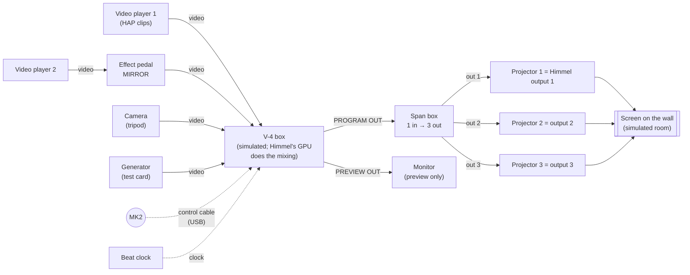
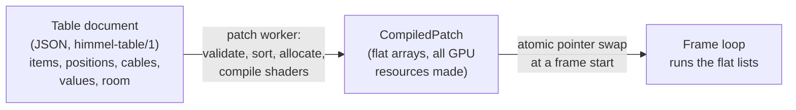
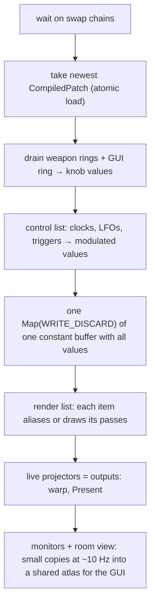
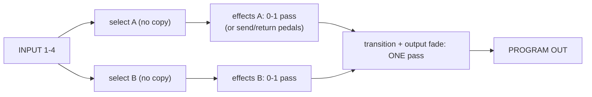

# The VJ table: patch the boxes you have (design proposal)

**Status: proposal, 2026-11-10. No engine code yet.** Decisions marked
**[owner]** are open; the owner decides them (see
[Open decisions](#11-open-decisions-for-the-owner)).

Mockup: [`vj-table-mockup.html`](vj-table-mockup.html) (open it in a browser).

## The idea (owner, 2026-11-10)

Like Reason, you route signal chains with cables between inputs and outputs.
But **not in a 19" rack**: the boxes do not fit there. Instead:

- **The boxes stay as they are.** The weapons we have drawn (MK2, V-4,
  Lightpad, LUMI …) lie **on a table**, looking like themselves, with their
  real inputs and outputs. You plug cables between them.
- **You can put more things on the table**: video players, cameras, effect
  pedals, small **monitors** to watch any signal, and **projectors** pointed at
  a **screen** (lerret) hung on the wall.
- **The room is the output.** What the projectors throw on the simulated wall
  is what Himmel sends to the real outputs. So the table is a **VJ simulator**:
  you build a rig on screen, play it, and the real show comes out.
- **Start with what exists** (weapons, simulators, clip player, camera, test
  card) and add effects and functions bit by bit. Then put things together and
  play.

Goals, in the order from `CLAUDE.md`:

1. **Show-safe**: a broken box, cable or rig never takes down the output.
2. **Minimal latency**: a knob turn reaches the screen in the next frame.
3. **Easy to use**: it looks like a real rig; ready-made tables; you can
   play without ever touching a cable.
4. **Light on the GPU**: a box costs nothing when it is not seen, simple
   effects cost one cheap pass or less.

---

## 1. What lies on the table



Every thing on the table is an **item**. Under the hood all items are the
same kind of object (a *device* with ports and parameters, section 2); on the
table they look like what they are:

| Item | Looks like | What it does in Himmel | Exists today |
|---|---|---|---|
| **Box** (a weapon with a video engine) | Its weapon drawing, e.g. the V-4 | Its panel works as on the simulator; its video work is done by Himmel's own GPU code | V-4 profile + simulator, effect catalogue (`docs/v4-effects.md`) |
| **Controller** (a weapon without video) | Its weapon drawing: MK2, Lightpad, LUMI | Plays boxes and items through control cables | MK2 (C++ driver), Lightpad, LUMI (Python) |
| **Video player** | A small media player with a screen | Plays HAP clips | `ClipPlayer` |
| **Camera** | A webcam on a tripod | Captures a camera | `CameraCapture` |
| **Generator** | A small box | Test card, colour, gradient, noise | Test card |
| **Effect pedal** | A guitar-pedal-like box with a footswitch and 2-3 knobs | One effect (one of the 96 V-4 patterns, later ISF) | — (new, cheap shaders) |
| **Clock** | A small box with a BPM display and TAP | Tap, Ableton Link, Pro DJ Link, audio | — |
| **Modulator** | A small box (LFO, envelope, step sequencer) | Moves knobs by itself | — |
| **Span box** | A splitter box (1 in, 2-4 out) | Span / mirror / triptych of one picture across outputs | Span / mirror in the renderer |
| **Monitor** | A small screen on a stand | Shows any signal. **Preview only**, never a show output | — |
| **Projector** | A projector with a light cone | **A real Himmel output** when it is "live" (see 1.2) | Outputs in `himmel_render` |
| **Screen / wall** | A screen (lerret) or a wall in the room | Where the projectors land; the room view | — |
| **LED wall / TV** (later) | A flat screen on the wall | A real output, no keystone | — |

### 1.1 Real or simulated

A box on the table always runs on **Himmel's own code**; the drawing is just
its face. The V-4 on the table does not need a real V-4 (the owner has none):
the drawn panel works with the mouse (the simulator), and the mixing and
effects are Himmel's GPU rebuild of the V-4's catalogue.

If the **real** device is connected (a V-4 over MIDI, the MK2 over USB), its
controls drive the box on the table: move the real T-bar and the drawn one
moves. The real V-4's own video path is not used (its video is SD analogue);
a capture card could later make it a source like a camera.

### 1.2 Projectors, screens and the room

- The table has a **room view** above it: a wall with one or more screens.
  Projectors on the table throw their picture onto the wall; you see the
  overlap and the edges as in the room.
- A projector has a switch **LIVE → output N**. Live projectors are Himmel's
  real outputs (display N, the same outputs `himmel_render --outputs N` opens
  today). The room view then shows **exactly** what goes out, at low
  resolution. A projector that is not live is a rehearsal projector: it only
  exists in the simulator.
- Later the room grows into the mapping tool (`CLAUDE.md`: keystone, mesh warp,
  edge blend): drag the corners of the projected picture on the wall, and the
  real output gets the same warp. The **Setup Mapping** mockup is the detailed
  view of this.
- Default room = the default rig: **3 screens side by side**, 3 projectors,
  span.

### 1.3 Monitors

A monitor can hang on **any** video cable or output: a clip player, the V-4
PREVIEW OUT (the 4-input multiview), after a pedal. It costs almost nothing
(a small copy at low rate, only while the monitor is on screen) and is never a
show output. This is the "look anywhere in the chain" tool.

---

## 2. The item model (ports and parameters)

### 2.1 Ports

| Type | Carries | Per frame | Cable colour | Drawn as |
|---|---|---|---|---|
| **Video** | A texture reference (SRV, size, alpha). Premultiplied alpha. | one texture | blue | the box's real video sockets (BNC / RCA / S-Video / HDMI look) |
| **Control** | One `float`, 0..1 or −1..1 | one value | green | a small jack ("CV") |
| **Trigger** | Rising edges this frame + gate + velocity | small struct | orange | a small jack ("GATE") |
| **Clock** | BPM, beat position, beats per bar, running | small struct | purple | a DIN-like socket ("CLOCK") |
| **Remote** | "This controller plays that item": a control cable from a weapon | — | white | USB / MIDI socket |

- **Real sockets first.** A box shows the sockets the real device has: the V-4
  has INPUT 1-4, PROGRAM OUT, PREVIEW OUT, MIDI IN / OUT. Himmel can add sockets
  the real one does not have (CV in for the T-bar, trigger in for TAKE, clock
  in); those sit on a **Himmel strip** on the box's edge, drawn in Himmel's
  style, so it is clear what is real and what is extra.
- **One cable per input, many per output** (fan-out is free: the same
  texture or value). Merge with a mixer or a Merger item.
- **Unpatched inputs have a defined value**: video = black, control = the knob
  itself, trigger = nothing, clock = the table's master clock.
- **Types never convert silently.** A small Converter item does it on purpose.
- Audio is not a cable type in the first version: an **Audio Analyzer** item
  turns sound into control, trigger and clock outputs.

### 2.2 Parameters

Every knob, fader, button and selector on an item is a **parameter**: a stable
id (`"tbar"`, `"fx_a.control"`), range, default, unit, display format,
optional Smart Random hints (safe range, mood tags), and optionally a control
input on the item that **modulates** it: `value = clamp(knob + amount × cable)`.
The drawn knob stays where you put it; a thin ring shows the modulated value.

### 2.3 Where the face comes from

- **Boxes and controllers** use their weapon profile (`weapons/<id>.weapon.json`,
  the format the live view already draws). The profile gets a new optional
  `ports` list: id, type, direction, position on the drawing, label, and
  `real: true/false` (real socket or Himmel strip). The live view and the
  table draw the same panel.
- **Small items** (players, pedals, clocks, monitors, projectors) get a simple
  item profile in the same spirit (`items/<id>.item.json`): size, controls,
  ports, look. Most can use one generic drawing (a box with a name, a few
  knobs, a screen).
- The drawing says "HIMMEL · V4", never the maker's logo (see
  `THIRD_PARTY_NOTICES.md` §8).

### 2.4 What an item type implements (C++ sketch)

```cpp
struct ItemType {
    const char* id;                      // "v4", "video_player", "pedal_mirror" ...
    std::span<const PortDesc>  ports;
    std::span<const ParamDesc> params;
    GpuCost cost;                        // declared passes + resolution, for the budget

    // Worker thread: may allocate, compile shaders, open files and devices.
    std::unique_ptr<ItemState> (*create)(const CreateContext&);
    // Frame loop: no allocation, no locks, no waiting, no disk.
    void (*control)(ItemState&, const ControlIn&, ControlOut&);   // CPU, every frame
    void (*render)(ItemState&, const RenderIn&, RenderOut&);      // GPU, only if seen
};
```

`render` may **alias** its output to an input (no pass at all) when it has
nothing to do: a pedal switched off, the V-4 T-bar resting on one side with no
effects. Only native item types, plus ISF shader pedals later. **No DLL
plug-ins in the renderer** (a third-party DLL can crash the process that
drives the screens). **[owner]**

---

## 3. From the table to the render graph (render-loop rules)

### 3.1 Three layers



1. **Table document**: what you built: items, where they lie, cables, knob
   values, the room (walls, screens, projector positions). JSON on disk
   (`shows/<name>/table.json`).
2. **CompiledPatch**: what the renderer runs. Built by a worker, never changed
   once published: a flat **control list**, a flat **render list** (only items
   that reach a live projector, a visible monitor or Spout / NDI), all
   textures, shaders and constant buffers already created, and one fixed-size
   **value block**.
3. **Frame loop**: walks the two lists. No names, no maps, no strings, no
   `new`.

Positions on the table and the room geometry do not change the graph; they are
GUI data (except projector warps, which are output parameters).

### 3.2 The patch worker

A thread in `himmel_render.exe`, outside the frame loop:

1. takes an edit (GUI, file, or a preset that changes cables);
2. **validates** (port types, one cable per input);
3. **sorts** the graph. A loop is only allowed through a **Frame Delay** item
   (video feedback = last frame); other loops are refused, with the reason on
   the cable;
4. **prunes** items nobody sees;
5. **allocates** textures from a pool, reusing one once its last reader has
   run (a typical table needs a handful of output-size textures);
6. **creates** new items and **moves the state** of items that survive (a
   playing clip keeps playing, an LFO keeps its phase);
7. **publishes** the new patch with one atomic pointer store.

The frame loop takes the newest pointer **at the start of a frame**. The old
patch is freed by the worker a few frames later, after a GPU fence.

### 3.3 Value changes vs cable changes

| Change | Example | Path | Frame-loop cost |
|---|---|---|---|
| **Value** | turn a knob, move the T-bar, recall a V-4 memory | straight into the value block (weapon rings are already drained in the frame loop; GUI edits come through an SPSC command ring) | a store |
| **Cable / item** | plug a cable, add a pedal | patch worker builds a new patch | one pointer swap, a frame or two later |

### 3.4 One frame



A knob, an LFO and a pad hit reach the picture in the next Present, so the
measured ~8–15 ms MK2 → Present stays.

### 3.5 When something fails

| Failure | What happens |
|---|---|
| An item fails to start (shader error, missing clip, camera gone) | The item is **faulted**: its video output passes its main input through (sources: last good frame or black). A red LED on the item. The rest plays on. |
| A source is not ready (clip loading, camera reconnecting) | Last good frame. Never waits. |
| A bad edit (loop, wrong type) | Refused in the worker; the running patch is untouched. |
| The GUI dies | Nothing changes on the wall. The renderer owns the live table; the GUI reconnects and reads it back. |
| A controller dies (cable pulled) | The items keep their values ("MK2 OFF", as today). |
| The renderer dies | The supervisor restarts it (< 1 s). It loads the **last good table** from the autosave the patch worker writes after each successful compile. |
| The same table kills the renderer twice | **Quarantine**: the item type added or changed last starts bypassed, and the GUI says so. |
| Everything is wrong | **PANIC** (on the table and on a weapon): all live projectors cut to the safe source (black or a logo) in the next frame, bypassing the graph. |

A live projector is never left without a picture: if its cable is pulled or
its source is faulted, it shows the safe source, never the desktop.

### 3.6 Processes

- **`himmel_render.exe`** owns the live table: the patch worker, the compiled
  patch and the value block (weapons and modulators change values every
  frame, so it is the authority).
- New shared block **`Local\HimmelTable`** (seqlocks): patch revision, every
  parameter (knob and modulated value), item states (ok / faulted / bypassed),
  GPU time per item; plus the GUI's command ring (values) and patch mailbox
  (a new table document with a revision number).
- **Thumbnails** for monitors, video-player screens and the room view: drawn by
  the renderer into one shared texture atlas at ~10 Hz, only for what the GUI
  has on screen, handed over with an index flip like the camera triple buffer.
  No keyed mutex, no waiting.
- Weapons stay in their controller processes (event rings, as today). Sync
  bridges (Link, Pro DJ Link, LTC) publish a clock in shared memory; the
  **Clock** item reads it.

---

## 4. Worked example: the V-4 on the table

The V-4 is weapon no. 7: the drawing (`weapons/v4.weapon.json`) and the
simulator (`tools/v4_sim.py`) exist, and so does the full effect and transition
catalogue ([`v4-effects.md`](v4-effects.md)). On the table it becomes the first
**box with a video engine**.

### 4.1 Its sockets

| Where | Sockets | Real V-4? |
|---|---|---|
| Back edge | **INPUT 1-4** (video in) | yes |
| Back edge | **PROGRAM OUT**, **PREVIEW OUT** (4 inputs + program, multiview) | yes |
| Back edge | **MIDI IN / OUT** (remote: a controller plays it; the real V-4 connects here) | yes |
| Himmel strip | CV in: T-bar, CONTROL A, CONTROL B, output fade | Himmel extra |
| Himmel strip | Trigger in: TAKE, CUT, TRANSFORMER A / B, TAP, memory next | Himmel extra |
| Himmel strip | Clock in (BPM SYNC) | Himmel extra (the real one takes MIDI clock) |
| Himmel strip | Send / return A and B: put **pedals into a channel** after the source select | Himmel extra |
| Himmel strip | Out: CH A, CH B (after effects), T-bar CV, beat / on-A / on-B triggers | Himmel extra |

So you can play it exactly like a V-4, and when you want to go further you
patch the strip: an LFO into the T-bar, a clock into BPM SYNC, a pedal into
channel B.

### 4.2 Its panel

Exactly the simulator's panel: INPUT A / B 1-4, the 4 effect buttons and
CONTROL dial per channel, MIX / WIPE / EFX, the T-bar, Transformer A / B, BPM
SYNC + TAP, output fade, memories 1-8. Every control is a parameter (`src_a`,
`fx_a.1`…, `tbar`, `trans`, `fade` …). The effect assignments per button,
PinP boxes and key settings are parameters too, stored in memories.

### 4.3 How it renders, and what it costs



- **Source select** is just which texture is bound.
- **Effects**: the 96 patterns are tiny pixel shaders, one per family, with the
  variant and CONTROL value as constants. Several active effects on a channel
  are **fused into one pass** (UV effects change where we sample, colour
  effects change the sample: `colour(sample(uv_effects(uv)))`). Fused variants
  are compiled in the worker when a button assignment changes. STILL and
  STROBE cost no shader: they hold a frame.
- **Transition**: one shader for all 248 (mix, 72 wipe shapes × 3 edges, keys,
  27 slides). Output fade is folded into the same pass.
- **Nothing to do = nothing drawn**: T-bar on A, no effects, no fade →
  PROGRAM OUT *is* the input texture. Channel B is not drawn while the T-bar
  rests on A.

| State | Fullscreen passes |
|---|---|
| T-bar on one side, no effects | 0 |
| T-bar on one side, effects on it | 1 |
| Mid-transition, effects on both | 3 |

Rough cost (estimate; to be measured): a simple fullscreen pass at 1080p moves
~16 MB, about 0.1–0.2 ms on the dev GTX 1070 and well under 0.05 ms on the
RTX 5090. Worst case for the V-4 under 1 ms on the 1070.

Note: the real V-4 is SD (720×576 / 720×480). Himmel's V-4 runs at the
resolution of its inputs (HD and up); the look of the effects is rebuilt, not
the SD picture.

### 4.4 Memories

The V-4's 8 memories become 8 **item presets** of the V-4 box (memory 1 is the
factory set, read-only). Recalling one only changes values, so it is instant.

---

## 5. Controllers on the table

A controller plays items in two ways; both end up as a write into the value
block in the frame loop.

### 5.1 Remote cable (the normal way)

Plug a **remote cable** (white, drawn as USB / MIDI) from the controller to
an item. The controller then plays that item with the item's **default
page**: e.g. MK2 → V-4 gives pads 1-4 = input A, 5-8 = input B, 9-16 = effects
A1-B4, knob 1 = T-bar, knobs 2-3 = CONTROL A/B, knob 4 = fade, Group A/B =
Transformer A/B, Play = TAKE, Shift + pad = memory. The MK2 screens show the
item's page (the Perform page already drawn in `pages.h`). One controller can
have remote cables to several items; the master encoder picks which one the
knobs play (browse/select wheel, as decided), Page < / > picks the page.

To change one mapping: **click a control on the item, then move a control on
the weapon** (the same click-then-press learning as the live view). The
mapping is stored in the table, not in the item, so the same table works with
another controller, or a simulated one.

| Weapon control | Behaviour |
|---|---|
| Endless knob / encoder (MK2 deltas) | value += delta × sensitivity; never jumps; Shift = fine |
| Absolute fader (V-4 T-bar, Lightpad y) | **pick-up**: follows only after passing the current value |
| Button | toggle or hold |
| Pad / key with velocity and pressure | trigger with velocity; pressure → a value |
| Surface (Lightpad x / y / z per finger) | up to three values per finger |

Feedback goes back the same way: LEDs light for toggles and selected inputs,
the screens show names and values; sent at the controller's own rate (the
controller already sends only what changed).

### 5.2 Control outputs (the patching way)

A controller also has **CV and gate outputs** on its Himmel strip: knobs as
control outputs, pads and buttons as trigger outputs (with velocity), pad
pressure as control. Patch them like any cable: one pad → TAKE on the V-4 and
RESTART on a video player at the same time; Lightpad finger y → a pedal's
amount.

---

## 6. Presets and the existing preset levels

| Level (`CLAUDE.md`) | On the table | Contains | Recall is |
|---|---|---|---|
| **Effect preset** | **Item preset** | The values of one item (a V-4 memory, a pedal setting) | a value change, instant |
| **Deck preset** | **Group** (e.g. a pedalboard, or "video player + 2 pedals") | Several items, their cables between them, their values, optional macro knobs | a cable change (worker, 1-2 frames) |
| **Session preset** | **Table** | Everything: items, cables, values, remote cables, room | a cable change |

- Value-only recalls are instant and can **morph** over time or beats.
- **Scenes and cues** (setlist → song → cue → scenes) store value snapshots
  of the table (all or some items). A cue fired by beat or timecode is almost
  always a value change.
- **Smart Random and themes** work on parameters: random values inside each
  parameter's safe range, item presets whose mood tags match the theme.
- **File format** `himmel-table/1` (JSON): items (`id`, `type`, position,
  values, state such as V-4 memories), cables (`from: "player1.video_out"`,
  `to: "v4.input1"`), remote cables and learned mappings, the room (walls,
  screens, projectors, live output numbers). Parameter and port ids are
  stable; new item versions migrate old values in the worker.
- **Ready-made tables** make it easy for beginners: *V-4 classic* (2 players,
  camera, test card → V-4 → 3 projectors span, MK2 on the V-4), *One deck*
  (player → pedal → projector), *Camera show*.

---

## 7. GPU cost (goal: cheap)

1. **Only what is seen is drawn**: items that reach no live projector or
   visible monitor are pruned; mixers skip a side at 0 %.
2. **Nothing to do = no pass**: aliasing.
3. **Fuse** chains of simple effects (pedals in a row, V-4 effect buttons)
   into one pass, in the worker.
4. **Never copy**: sources hand over their own textures (HAP BC textures; the
   camera's NV12 is converted in the first pass that reads it).
5. **Texture pool** with reuse.
6. **Monitors and the room view** are small copies at ~10 Hz, only while on
   screen.
7. **8-bit (RGBA8) by default**; 16-bit float only where an item asks
   (feedback, heavy keying). **[owner]**
8. **Measure every item**: GPU timestamp queries per item, read back 3 frames
   late (never waits). Each item shows its cost; the table shows the total
   against a **budget**, proposed 4 ms per frame at 60 Hz on the dev 1070 at
   1080p. The item drawer shows each item's expected cost before you add it.

---

## 8. The table view in the operator GUI (Dear ImGui)

Mockup: [`vj-table-mockup.html`](vj-table-mockup.html) (HTML sketch for
content and layout, not production code).

- **Room view on top**: the wall with the screens and the projected pictures
  (live outputs marked LIVE 1-3). Later: drag picture corners for keystone.
- **The table below**, seen from above: items lie where you put them. Pan
  (drag the empty table) and zoom (wheel). Drag an item by its edge to move it.
- **Items look like themselves**: the weapons as drawn by the live view, small
  items as simple boxes. Their controls work right on the table (knobs, the
  T-bar, buttons, footswitches).
- **Sockets on the edges**: real sockets on the back edge, Himmel's extra
  sockets on a **Himmel strip**. Cables lie on the table as soft curves,
  coloured by type. Drag from a socket to a socket; only sockets that fit
  light up. Click a cable to pull it out. Hover a cable to see its value (or a
  small picture for video).
- **Monitors** show live pictures; a **projector** has LIVE / output number
  and a light cone toward the wall.
- **Item drawer** on the side: items by family with their expected GPU cost,
  item presets and ready-made tables. Drop an item near a cable and it is
  patched into it (auto-cabling).
- **Top bar**: patch revision, GPU total vs budget, master clock, PANIC.
- In ImGui: one canvas child window with its own pan / zoom; items drawn with
  `ImDrawList` from their profiles; cables with `AddBezierCubic`; thumbnails
  from the shared atlas as `ImTextureID`s.

---

## 9. Items to start with

| Family | Item | Main ports | GPU |
|---|---|---|---|
| Box | **V-4** (weapon no. 7 + Himmel engine) | section 4 | 0–3 passes |
| Controller | **MK2**, **Lightpad**, **LUMI**, later others | remote out; CV / gate outs | CPU |
| Source | **Video player** (`ClipPlayer`) | video out; trigger in play / restart / next; CV in speed; clock in | upload only |
| Source | **Camera** (`CameraCapture`) | video out | none extra |
| Source | **Generator** | video out; CV in | 0–1 cheap pass |
| Effect | **Pedals**: one V-4 effect family each (negative, colorize, monocolor, posterize, colorpass, mirror, multi, strobe, still, shake, keys) | video in / out; CV in amount; trigger in on/off | 0–1 pass, fused |
| Effect | **Frame Delay** (feedback) | video in / out | 1 copy |
| Mixer | **Crossfader** (2 in), later a layer mixer | video in ×N, out; CV in | 0–1 pass |
| Clock | **Clock** (tap, Link, Pro DJ Link, audio, LTC) | clock out; beat / bar triggers | CPU |
| Modulator | **LFO**, **Envelope**, **Step sequencer** | CV / trigger | CPU |
| Utility | **Merger / Splitter / Converter** | CV / trigger | CPU |
| Output | **Span box** (1 → 2-4: span, mirror, triptych, chase) | video in, outs | 0 (sub-rectangles) |
| Output | **Projector** (LIVE → output N), later **LED wall / TV** | video in | the existing output path |
| Look | **Monitor** | video in | tiny copy, ~10 Hz |
| Later | Spout / NDI in and out, Audio Analyzer, ISF pedals | | |

---

## 10. First milestone (small)

**M1: the table runs, without the table GUI.** Prove the core (worker
compile, swap, no allocation in the frame loop, failures, measuring) with the
V-4 classic table played from the MK2.

1. **`himmel_table` library** (`src/table/`): port and parameter tables, the
   `himmel-table/1` reader, the patch worker, the value block, item-state hand
   over. **Unit tests without a GPU** (`tests/table/`): sorting, refused loops,
   Frame Delay loops, pruning, aliasing, texture reuse, faulted items passing
   through, value vs cable changes.
2. **Items**: Video player, Camera, Generator, **V-4** with MIX + 4 wipe shapes
   (hard and soft) + 2 slides + output fade + TAKE, two pedals (NEGATIVE and
   MIRROR), Clock (tap), Span box, Projector ×3 (live).
3. **`himmel_render.exe --table shows/v4-classic/table.json`**: loads the table
   in the worker and **reloads it when the file changes** (edit the JSON, the
   wall changes a frame or two later).
4. **MK2 remote cable** to the V-4 with its default page (pads, knobs,
   screens).
5. **Measurements** in the log and on the MK2 screen: GPU time per item,
   compile time, frames from edit to swap, late frames during 100 fast edits
   (target: zero).
6. **Failure tests**: a shader that does not compile, a missing clip, a camera
   pulled out, a loop in the file, killing the renderer mid-show (it comes back
   with the last good table).

**M2: the table view.** First as a page in the existing browser live view
(`tools/mk2_live.py` already draws the weapons from their profiles and talks
to the engine), so the owner can lay out and patch a table early; then the
same in the Dear ImGui GUI. **[owner]** for the browser-first step.
**M3:** all V-4 effects and transitions, the simulated and the real V-4
playing the V-4 box, monitors, room view with keystone. **M4:** groups, item
presets, Smart Random over parameters, ISF pedals.

---

## 11. Open decisions for the owner

1. **The table is the main way to build a show**, and today's fixed engine
   (test card, clip layer, camera layer) becomes a ready-made table. Decks /
   layers become groups on the table. This changes the main concepts in
   `CLAUDE.md`.
2. **The renderer owns the live table**; the GUI is a view that sends edits
   (a GUI crash never changes the show).
3. **No DLL plug-ins in the renderer**; user effects are ISF pedals.
4. **RGBA8 by default**, 16-bit float only where an item asks.
5. **Browser table view first** (in the live view), ImGui later.
6. **Names and format**: "table" / "item" / "pedal" / "Himmel strip",
   `himmel-table/1`, items drawn as "HIMMEL · V4". The format becomes public
   (MIT, open repo), so changing it later means migrations.
7. **GPU budget**: 4 ms per frame on the 1070 at 1080p as the warning line.
